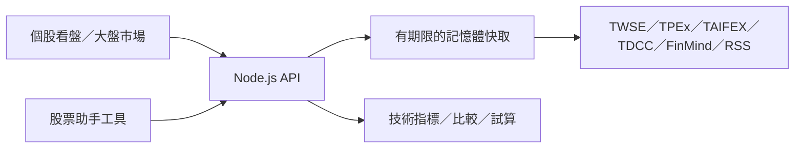
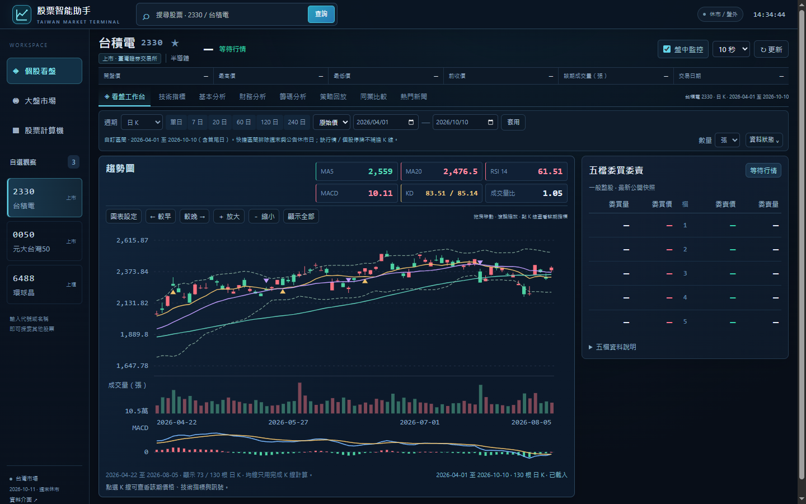
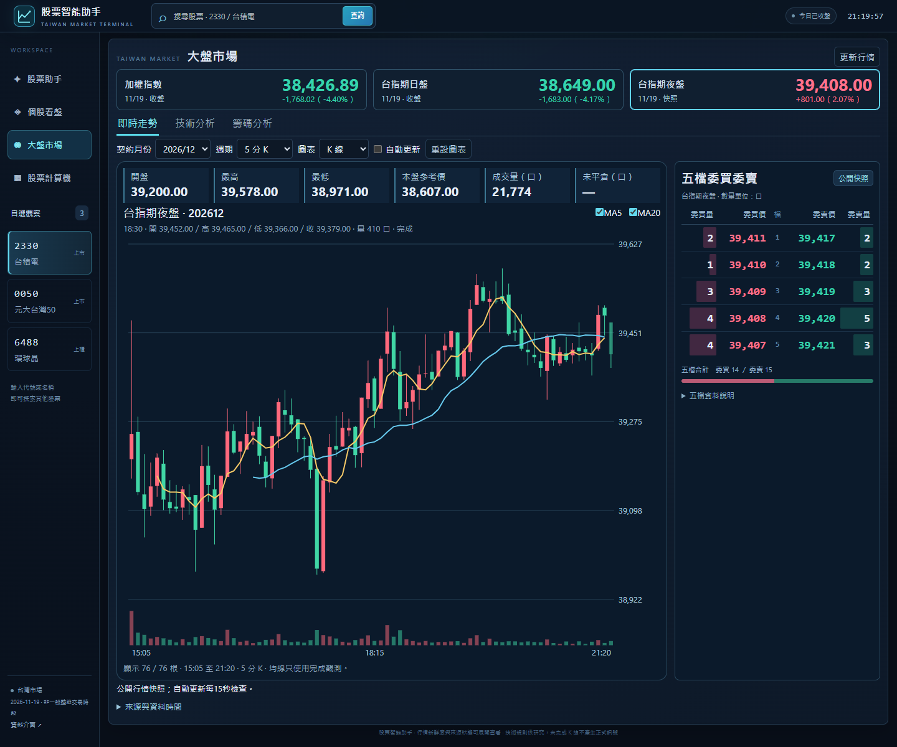
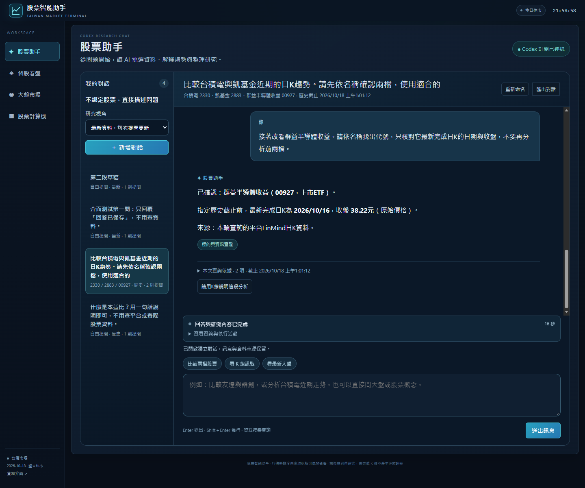

# 股票智能助手｜TWStock Coach

[](LICENSE)


開源台股看盤與研究平台，整合個股、大盤、技術分析、財務、籌碼、同業比較、新聞及交易成本試算。前端採 Vite／Bootstrap／JavaScript MVC，後端採 Node.js／Fastify。

**個股看盤與大盤市場完全使用「來源 API＋記憶體快取」。** 專案已移除 PostgreSQL 驅動、SQL 初始化、股票資料庫讀寫與持久排程。來源未提供、權限不足或查詢失敗時保留缺漏，不以零值或推估行情代替。

目前套件版本為 **1.2.0**，仍在開發。版本徽章不代表已設定遠端 CI 或已發布 Release。

## 快速開始

需求：Node.js ≥22.16、npm，以及執行後端容器所需的 Docker Compose。

```sh
npm ci
npm run setup
docker compose up -d --build api
npm run dev
```

- 前端：`http://127.0.0.1:5173`
- API 文件：`http://127.0.0.1:8000/docs`
- 健康檢查：`http://127.0.0.1:8000/health`

健康檢查回傳 `data_mode: source_api`、`database_used: false`，不需要 PostgreSQL。也可以用 `npm start` 在本機啟動 API；前端另行啟動。

`npm run setup` 建立本機 `.env`，不覆寫既有設定。`FINMIND_TOKEN` 選填，但分鐘線、部分分點及持股資料需要相應權限。公開資料並不代表完整即時行情或無限額度。

## 資料取得方式



| 資料               | 取得方式與限制                                                   |
| ------------------ | ---------------------------------------------------------------- |
| 股票目錄           | 來源 API 取得後記憶體快取，無 instruments 寫入                   |
| 上市原始日線       | 2010 年起優先 TWSE 官方月歷史；失敗時 FinMind 備援，保留實際來源 |
| 上櫃歷史、還原價   | 沿用 FinMind；不將官方歷史張數冒充精確股數                       |
| 分鐘線             | 具權限的來源；公開報價快照不拼成假的分鐘 OHLC                    |
| 即時價格與五檔     | 公開行情接口與短期快取，非逐筆串流                               |
| 財務與籌碼         | 按需向來源查詢，各資料集完成後逐步呈現；不使用持久工作佇列       |
| 同業比較           | 股票目錄與記憶體中的來源財務資料，缺資料可按需取得               |
| 大盤、台指期日夜盤 | 官方行情接口／歷史統計與 FinMind，區分契約與盤別                 |
| 新聞與公開討論     | FinMind／RSS／公開文章，非完整新聞歷史庫                         |
| 技術指標           | 平台以實際 K 線計算，不由語言模型編造                            |

前端主要資料入口為 `GET /api/stock-data/:market/:symbol?section=chart|basic|financial|equity`，回傳 `data`、`state`、`storage: memory`、`database_used: false`。冷啟動可能先回傳 `updating`，前端重新查同一資料入口；不操作工作 ID。八個區塊的來源與計算路徑列於[架構設計](docs/DESIGN.md#八個個股區塊的資料路徑)。

**記憶體快取會在服務重啟後消失。** 沒有資料庫修訂歷史，因此無法重建「某一天當時已公告／當時平台已取得」的財務與籌碼版本；歷史價格區間回看仍可使用來源歷史資料。財報期間不等於公告日期。

## 主要功能

- 個股搜尋、歷史區間、日／週／月 K、可用來源的分鐘／小時 K、拖曳縮放。
- 均線、RSI、MACD、KD、布林、ATR及完成 K 棒技術事件。
- 財務五類細項、歷史趨勢與資料表；實際數值依來源與必要科目。
- 法人、外資持股、融資融券、集保、董監等籌碼觀察；分點需來源權限。
- 同業比較、公司新聞與公開討論。
- 加權指數、台指期日夜盤、五檔及市場籌碼；指數本身沒有五檔。
- 股票與當沖成本試算、合法跳檔與漲跌情境。
- 選配的訂閱 Codex 股票助手，依描述辨識標的、按需查工具與保存對話／研究內容。

技術事件與回測不保證未來績效。來源空值不補零，未完成 K 線不產生正式收盤訊號。尚未接入的法人目標、基金持股揭露等不以代理數字代替。

## 本機 Codex CLI 與 AI Agent

股票助手是獨立本機 Node.js 服務，不加入 Compose，也不需要模型 API Key。

```sh
codex login
npm run assistant:setup
npm run assistant:start
```

使用 ChatGPT 訂閱登入。前端將 `/api/assistant` 代理到 Agent 的 `8010`，其他股票 API 送至 `8000`。

每個 Session 獨立保存；Codex 使用原生 agent loop 與指定 thread 接續，透過 MCP 查資料。技能位於 `agent/skills`，提供查證、技術、比較及持倉方法，不含固定股票答案。文字與活動以 SSE 顯示，不提供內部推理或保證逐 Token。

對話與研究內容保存在 `sessions/`；舊 `reports/` 為檔案封存。這些檔案不屬於股票 DB。來源模式沒有可還原的歷史 DB 快照，助手的歷史研究能力受到同樣限制。

## 介面預覽





截圖位於 `web/public/images/screenshots/`；資料日期及部分文字可能與最新執行結果不同。

## 目錄

```text
api/          Node.js API、來源轉接、記憶體快取與計算
web/          Vite 前端、MVC 模組與 public 資產
agent/        本機 Codex 橋接、MCP、技能及 Session
scripts/      啟動與驗證工具
docs/         架構設計、功能設計
```

## 部署與設定

`docker compose up -d --build api` 僅啟動 API；Compose 沒有資料庫、scheduler 或前端服務。前端獨立啟動或部署。升級不需要執行 `init.sql`、資料遷移或匯入；既有本機備份、Session、報告與歷史資料卷不在本次清理範圍。

前端執行 `npm run build`，部署 `web/dist` 至獨立靜態主機，代理 `/api`、`/health`、`/docs`、`/openapi.json` 至後端；範例見 [Nginx 設定](web/deploy/nginx.conf)。啟用助手時優先代理 `/api/assistant` 至 `8010`。

| 設定                                         | 用途                             |
| -------------------------------------------- | -------------------------------- |
| `FINMIND_TOKEN`                              | 相應資料權限，非所有資料皆免費   |
| `INGEST_API_KEY`                             | 僅保留已停用舊匯入接口的認證邊界；一般看盤不使用 |
| `FINMIND_REQUEST_INTERVAL`                   | FinMind 請求間隔，預設1秒        |
| `FINMIND_HOURLY_BUDGET`                      | 單一 API 程序滾動一小時請求預算，預設300次；依實際來源權限調整 |
| `ETF_WATCHLIST`                              | 具權限的指定主動 ETF 持股查詢    |
| `GOOGLE_NEWS_ENABLED`                        | 選配 Google RSS                  |
| `ASSISTANT_ACCESS_KEY`                       | 助手平台存取密碼，非模型 API Key |
| `ASSISTANT_STOCK_API_URL`                    | 助手使用的股票 API 位址          |
| `API_PROXY_TARGET`／`ASSISTANT_PROXY_TARGET` | Vite 啟動環境中的代理目標        |

## 驗證與文件

```sh
npm test
npm run build
npm run verify
npm run verify:browser
```

單元測試包含來源辨識、資料單位、快取、無 DB 依賴、認證邊界、Session、計算與技術事件。API 驗證涵蓋八個個股區塊與實際策略回放；瀏覽器驗證量測區塊切換、有效資料、新聞先顯示及桌機／手機排版。外部來源需可用，冷載入耗時與畫面切換耗時分開評估，不保證來源服務永遠秒開。

- [架構設計](docs/DESIGN.md)
- [功能設計](docs/FEATURES.md)

## 貢獻與授權

歡迎回報包含重現步驟、資料日期與來源狀態的問題。提交前請執行相關測試及建置；勿提交 `.env`、對話、備份或來源憑證。

本專案採 [MIT License](LICENSE)。外部資料的使用條件依各來源規範，不因專案程式採 MIT 而改變。
