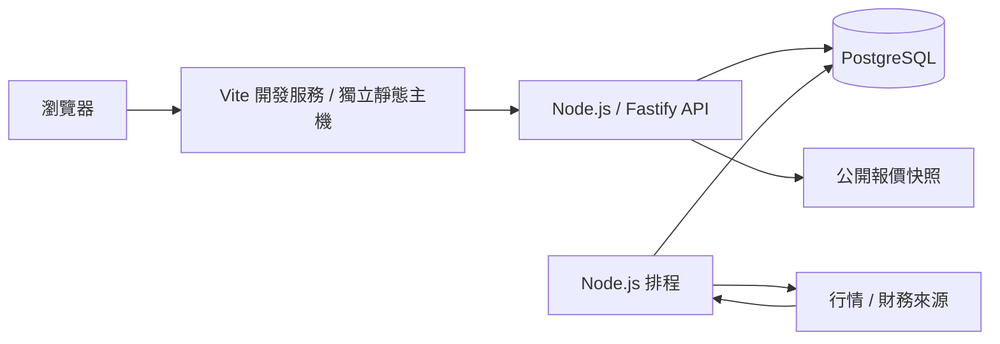

# 股票智能助手｜TWStock Coach

[](CHANGELOG.md)
[](LICENSE)


開源台股看盤與研究平台，整合歷史行情、技術分析、財務資料、籌碼觀察、同業比較與交易成本試算。前端採 Vite 與 JavaScript MVC，後端採 Node.js／Fastify，資料儲存於 PostgreSQL。

**前端與 API 獨立啟動、建置及部署。** Docker Compose 管理後端、排程與資料庫；看盤頁面由前端服務提供。核心分析由程式執行，不依賴大型語言模型或 Token 型助手。

[快速開始](#快速開始) · [介面預覽](#介面預覽) · [功能與資料覆蓋](#功能與資料覆蓋) · [部署](#部署) · [貢獻](#貢獻與授權)

## 版本與專案狀態

| 項目         | 說明                                                            |
| ------------ | --------------------------------------------------------------- |
| 目前程式版本 | **1.2.0**，前後端套件與 OpenAPI 版本同步                        |
| 狀態         | 持續開發；適合個人自選股監控與研究                              |
| 授權         | [MIT](LICENSE)                                                  |
| 版本標記     | 建議 Git tag：`v1.2.0`；程式版本更新不會自動發布 GitHub Release |
| 更新內容     | [CHANGELOG](CHANGELOG.md)                                       |
| 主要變更     | 三個獨立主菜單、前後端分離、共用五檔；工作及資料完整性修正      |
| 功能成熟度   | 已實作功能、來源權限限制與實驗性研究功能分開列示                |

上方徽章表示版本、技術及授權資訊，不代表已配置遠端 CI 或發布正式 Release。

建議 GitHub Topics：

```text
taiwan-stock twse tpex stock-dashboard technical-analysis financial-analysis
stock-calculator market-data nodejs fastify vite postgresql docker-compose
```

## 快速開始

### 環境需求

- Node.js **22.16 以上**；API 正式映像使用 Node.js 24。
- Docker Engine 與 Docker Compose v2。
- 可連線至行情與財務資料來源的網路環境。
- 瀏覽器驗證另需本機 Chrome；一般 API 測試不需要。

### 安裝與啟動

在專案根目錄執行：

```sh
npm ci
npm run setup
docker compose up -d --build --remove-orphans
npm run dev
```

`npm run setup` 建立 `.env` 並產生隨機資料庫密碼與匯入金鑰，不覆寫既有設定。首次排程會依自選清單回補資料，所需時間取決於日期範圍及來源限流。

| 服務     | 位址                                                     | 用途                       |
| -------- | -------------------------------------------------------- | -------------------------- |
| 前端開發 | [http://127.0.0.1:5173](http://127.0.0.1:5173)           | 看盤平台、熱更新、API 代理 |
| API      | [http://127.0.0.1:8000](http://127.0.0.1:8000)           | JSON 服務資訊與資料介面    |
| API 文件 | [http://127.0.0.1:8000/docs](http://127.0.0.1:8000/docs) | 互動式 Swagger 文件        |
| 健康檢查 | `http://127.0.0.1:8000/health`                           | API 與資料庫連線狀態       |
| OpenAPI  | `http://127.0.0.1:8000/openapi.json`                     | API 合約                   |

也可進入 `web/` 執行 `npm run dev`。前端的 `/api`、`/docs`、`/health` 與 `/openapi.json` 由 Vite 代理至本機 API。

### 前端建置與預覽

```sh
npm run build      # 產生 web/dist
npm run preview    # 本機預覽：http://127.0.0.1:4173
```

預覽服務仍需 API 運行。Vite preview 供本機驗證，正式前端請部署 `web/dist` 至獨立靜態主機。前端更新不需要重建 API 容器。

## 介面預覽

以下為平台實際運行畫面。畫面中的資料時間與來源狀態請以介面標示為準。

### 台股看盤工作台


### 加權指數與台指期


### 大盤籌碼與公司新聞

| 大盤籌碼                                                                              | 公司新聞與公開討論                                                            |
| ------------------------------------------------------------------------------------- | ----------------------------------------------------------------------------- |
|  |  |

主菜單切換「個股看盤／大盤市場／股票計算機」，內容在同一頁中央更新。股票計算機為獨立工具頁，可透過頂部搜尋選取股票，不顯示個股行情與研究分頁。個股的「熱門新聞」位於同業比較旁；大盤分為即時走勢、技術分析與籌碼分析。

大盤桌機版依視窗高度配置走勢、五檔、技術卡片與籌碼明細，已核對1280×720至1920×1080等常見尺寸同屏可見。大盤五檔與個股共用欄位、字體、紅綠配色、深度色帶與委託合計；期貨數量以口表示，代表尚未成交的委託契約數。排版驗證可執行 `npm run verify:market-layout`。

| 財務分析                                                                                      | 財務歷史趨勢                                                                                   |
| --------------------------------------------------------------------------------------------- | ---------------------------------------------------------------------------------------------- |
|  |  |

| 股票計算機                                                                                  | 同業比較                                                                                     |
| ------------------------------------------------------------------------------------------- | -------------------------------------------------------------------------------------------- |
|  |  |

截圖存於 `web/public/images/screenshots/`，建置時由前端複製至 `dist/images/`。

## 功能與資料覆蓋

| 模組           | 1.2.0 功能                                                                         | 可用性與限制                                                                                     |
| -------------- | ---------------------------------------------------------------------------------- | ------------------------------------------------------------------------------------------------ |
| 看盤與歷史行情 | 股票搜尋、自訂起訖日、分鐘／小時／日／週／月 K、拖曳縮放、數量單位與均線開關       | 日線依來源可得性；分鐘線需相應 FinMind 權限                                                      |
| 公開行情與五檔 | 公開報價快照、五檔、來源時間及行情新鮮度                                           | 非逐筆串流；歷史回看不拿現在五檔代替                                                             |
| 技術分析       | MA5／10／20／60／120／240、RSI、MACD、KD、ATR、布林通道、量比與完成 K 線訊號       | 需足夠完成 K 線及暖機資料；缺值不補零                                                            |
| 大盤市場       | 獨立主菜單、即時走勢、歷史技術指標、上市法人／融資融券、台指期法人、期貨日夜盤五檔 | 指數沒有委託五檔；籌碼為收盤日統計；期貨不拼接契約，指數日線只用官方收盤值                       |
| 公司媒體       | 公司新聞、右側公開討論、日期查詢、來源狀態、更多文章與外部搜尋                     | FinMind 公司索引一次查一個日期；Yahoo／PTT 是近期 RSS；Google RSS 需符合個人非商業條件後自行啟用 |
| 基本分析       | 公司資料與機構研究資料介面                                                         | 股利在財務分析；法人目標及研究報告需授權資料，並非內建完整覆蓋                                   |
| 財務分析       | 財務報表、獲利能力、安全性、成長能力、價值評估五類共 38 細項導覽；歷史圖表與表格   | 選單已實作；部分指標、河流圖等仍缺必要資料，詳見[內容核對](docs/FINANCIAL_PARITY_AUDIT.md)       |
| 籌碼分析       | 法人流量、分點代理、股權分布、ETF／基金持股與股／張換算                            | 依來源與權限；免費集保資料僅最新週，歷史需累積；不推測交易者身分                                 |
| 股票計算機     | 買入、賣出、當沖、零股、折扣、最低手續費、稅、損益及損益兩平；跨級距跳檔           | 費用用十進位計算；不判定帳戶是否可當沖，不含融資融券                                             |
| 同業比較       | 完整產業候選、業務相近組、共同期間、中位數、缺漏與過期資訊                         | 同產業不代表直接競爭；資料不足會明示                                                             |
| 策略回放       | 個股策略回放頁、次根開盤成交假設、成本與來源修訂                                   | **實驗性研究功能**；賣出稅預設 0，須自行設定，不模擬實盤成交限制                                 |
| 預測 API       | 還原日線 ridge 五期預測、滾動評估及基準誤差                                        | **僅 API，尚無前台預測頁**；至少165根完成還原日線，預設未啟用還原擷取                            |
| 資料工作       | 持久佇列、按需回補、自選股排程、限流重試、心跳與中斷恢復                           | 仍受來源配額、服務狀態與會員方案限制                                                             |

### 資料契約

- 股票代號使用字串，保留 `0050` 等前導零。
- 原始價與還原價分開；整股與零股交易類型分開。
- 成交量統一儲存為股，畫面按功能換算為張。
- 分鐘線使用具時區時間戳，日線另存交易日期；顯示採 `Asia/Taipei`。
- 行情具唯一鍵，重跑不新增重複正式資料；更新前保留修訂。
- 未完成 K 線明確標示，正式訊號只使用完成 K 線。
- 財務及同業比較核對共同期間、來源、接收時間與必要科目。

## 系統架構



| 層級     | 技術與部署方式                                            |
| -------- | --------------------------------------------------------- |
| 前端     | Vite 8、ES modules、Bootstrap 5、JavaScript MVC、SVG 圖表 |
| API      | Fastify 5、OpenAPI、JSON API；不提供股票工作台檔案        |
| 工作程序 | Node.js、PostgreSQL 工作佇列、排程與來源限流              |
| 資料庫   | PostgreSQL 17、SQL 遷移、行情唯一鍵與修訂                 |
| 計算     | 原生 JavaScript 指標／財務計算、decimal.js 費用運算       |
| 後端部署 | Compose：`postgres`、`api`、`scheduler` 三個服務          |
| 前端部署 | 獨立靜態主機，透過同源反向代理連接 API                    |

API 的 `/docs` 保留自己的文件頁與 Swagger 資源；股票頁面、圖片、CSS 與前端原始碼由前端服務管理。

### 專案結構

```text
TWStock-Coach/
├── api/                 # Node.js API、分析、資料來源、工作與 SQL 遷移
├── web/
│   ├── index.html       # Vite 入口
│   ├── src/             # MVC 模組、樣式與啟動程式
│   ├── public/images/   # README 截圖
│   ├── deploy/          # 獨立前端反向代理範例
│   ├── vite.config.js   # 開發／預覽服務與 API 代理
│   ├── package.json     # 前端版本與指令
│   └── dist/            # 建置產物，不提交版本控制
├── scripts/             # 設定與服務／瀏覽器驗證
├── tests/               # API 邊界回歸測試
├── docs/                # 架構、部署、分析及驗證文件
├── compose.yaml         # 後端服務
├── Dockerfile           # 獨立 API／排程映像
├── CHANGELOG.md         # 版本更新紀錄
├── CONTRIBUTING.md      # 貢獻流程
└── LICENSE              # MIT 授權
```

## 設定

| 變數                       | 用途                         | 預設或範例                                                     |
| -------------------------- | ---------------------------- | -------------------------------------------------------------- |
| `POSTGRES_PASSWORD`        | Compose 資料庫密碼           | setup 產生                                                     |
| `INGEST_API_KEY`           | 授權匯入的 `X-API-Key`       | setup 產生，不傳至前端                                         |
| `FINMIND_TOKEN`            | FinMind 會員權限             | 選填，依資料項目需相應方案                                     |
| `WATCHLIST`                | 定期更新清單，不限制前台搜尋 | `TWSE:2330,TWSE:0050,TPEX:6488`                                |
| `BACKFILL_START`           | 首次日線回補起日             | `2021-01-01`                                                   |
| `ENABLE_ADJUSTED`          | 另外擷取還原價               | `false`                                                        |
| `FINMIND_REQUEST_INTERVAL` | 來源請求間隔秒數             | `8`，最低 `1`                                                  |
| `ETF_WATCHLIST`            | 指定主動 ETF                 | 選填，最多 10 檔                                               |
| `GOOGLE_NEWS_ENABLED`      | Google 新聞 RSS 個人閱讀     | `false`；第三方用途限制見[公司媒體設計](docs/COMPANY_MEDIA.md) |
| `API_PROXY_TARGET`         | Vite 開發／預覽的 API 目標   | `http://127.0.0.1:8000`                                        |

修改後端 `.env` 後執行 `docker compose up -d api scheduler`。修改開發代理目標則重新啟動 Vite；設定方法見部署文件。

## 部署

**後端**：`docker compose up -d --build`。映像只包含 API、排程與驗證工具，不建置或打包 `web/dist`。

**前端**：`npm run build`，將 `web/dist` 部署至獨立靜態主機。主機需將 `/api`、`/docs`、`/health` 與 `/openapi.json` 代理至 API，保留完整路徑與查詢參數；提供 [Nginx 範例](web/deploy/nginx.conf)。純靜態檔案託管仍需另配置 API 代理或閘道。

API 預設綁定本機 `8000`，正式對外 HTTPS、程序管理及備份方式見 [部署與維護](docs/DEPLOYMENT.md)。`docker compose down -v` 會刪除資料卷，更新時應保留資料庫。

## 維護與驗證

```sh
npm test                 # API 隔離回歸測試，無需資料庫或行情來源
npm run format:check
npm run build
npm run verify           # 運行中的 API、資料庫與既有行情檢查
docker compose exec -T api npm run verify:db  # 隔離 schema 的資料庫整合測試
docker compose exec -T api npm run verify:worker  # 排程鎖、執行心跳與佇列
npm run verify:browser   # 預設驗證 5173 前端，需 Compose、Vite 與 Chrome
npm run verify:market
npm run verify:market-layout
```

目前 `npm test` 有 **33 項**：31項後端及2項前端；另有 **8項 PostgreSQL 整合測試**，建立專用隨機 schema，結束後只移除此測試 schema。涵蓋費用與跳檔、損益兩平、完成K線、缺值、財務來源、行情修訂、歷史接收時間、工作恢復、同業期間及快照回退。瀏覽器驗證另外檢查個股、38項財務導覽、獨立計算機、大盤與新聞及響應式版面。檢查結果與未完成範圍見 [功能與服務檢視](docs/REVIEW_2026-10-11.md) 及 [驗證紀錄](docs/VALIDATION.md)。

`API_BASE_URL` 可指定 API 驗證位址；`WEB_BASE_URL` 可讓服務驗證同時檢查前端。`BASE_URL` 用於瀏覽器驗證，例如改測 `4173` 建置預覽。

手動資料工作：

```sh
docker compose run --rm api node api/cli.js sync --start 2026-01-01 --end 2026-09-30
docker compose run --rm api node api/cli.js fundamentals
```

## 貢獻與授權

歡迎透過 Issues 提供可重現的問題與功能建議，或提交 Pull Request。請先閱讀 [CONTRIBUTING](CONTRIBUTING.md)，附上變更目的、驗證方式與資料口徑。

程式碼依 [MIT License](LICENSE) 授權。Bootstrap 等第三方程式保留各自授權；行情與財務資料須遵循原始來源的使用及轉載條件，MIT 不授予第三方資料權利。

## 專案文件

| 文件                                                | 內容                                 |
| --------------------------------------------------- | ------------------------------------ |
| [系統架構](docs/DESIGN.md)                          | 模組、資料契約、工作佇列與前後端邊界 |
| [部署與維護](docs/DEPLOYMENT.md)                    | 前後端獨立部署、代理、備份與日誌     |
| [分析設計](docs/ANALYSIS_DESIGN.md)                 | 基本、財務與籌碼分析                 |
| [財務導覽](docs/FINANCIAL_NAVIGATION.md)            | 五類 38 細項配置                     |
| [財務內容核對](docs/FINANCIAL_PARITY_AUDIT.md)      | 覆蓋、計算口徑與缺漏                 |
| [計算機與同業比較](docs/CALCULATOR_PEERS_DESIGN.md) | 費用、跳檔與比較規則                 |
| [大盤市場](docs/MARKET_BOARD.md)                    | 指數、期貨日夜盤、共用五檔與籌碼     |
| [公司新聞與公開討論](docs/COMPANY_MEDIA.md)         | 索引、RSS、日期與來源限制            |
| [功能與服務檢視](docs/REVIEW_2026-10-11.md)         | 本次修正、檢查證據與剩餘限制         |
| [文件索引](docs/README.md)                          | 全部文件的閱讀順序與維護原則         |
| [驗證紀錄](docs/VALIDATION.md)                      | 本次與歷史驗證的範圍及限制           |
