# 股票智能助手｜TWStock Coach

[](LICENSE)


開源台股看盤與研究平台，整合歷史行情、技術分析、財務資料、籌碼觀察、同業比較與交易成本試算。前端採 Vite 與 JavaScript MVC，後端採 Node.js／Fastify，資料儲存於 PostgreSQL。

**前端與 API 獨立啟動、建置及部署。** Docker Compose 管理股票 API、行情排程與資料庫；前端與選配 AI Agent 目前在本機執行。核心指標與交易條件由程式計算；股票助手使用獨立Session，由Codex依問題按需查詢平台資料，並可產出報告與K線引導。

[快速開始](#快速開始) · [本機 AI Agent](#本機-codex-cli-與-ai-agent) · [介面預覽](#介面預覽) · [功能與資料覆蓋](#功能與資料覆蓋) · [部署](#部署) · [貢獻](#貢獻與授權)

## 版本與專案狀態

| 項目         | 說明                                                                       |
| ------------ | -------------------------------------------------------------------------- |
| 目前程式版本 | **1.2.0**，前後端套件與 OpenAPI 版本同步                                   |
| 狀態         | 持續開發；適合個人自選股監控與研究                                         |
| 授權         | [MIT](LICENSE)                                                             |
| 版本標記     | 建議 Git tag：`v1.2.0`；程式版本更新不會自動發布 GitHub Release            |
| 主要變更     | 四個獨立主菜單、Codex CLI工具分析、查詢證據與K線引導；共用五檔與前後端分離 |
| 功能成熟度   | 已實作功能、來源權限限制與實驗性研究功能分開列示                           |

上方徽章表示版本、技術及授權資訊，不代表已配置遠端 CI 或發布正式 Release。

建議 GitHub Topics：

```text
taiwan-stock twse tpex stock-dashboard technical-analysis financial-analysis
stock-calculator market-data nodejs fastify vite postgresql docker-compose
```

## 快速開始

### 環境需求

- Node.js **22.16 以上**；API 正式映像使用 Node.js 24。
- Docker Engine 與 Docker Compose v2。
- 可連線至行情與財務資料來源的網路環境。
- 瀏覽器驗證另需本機 Chrome；一般 API 測試不需要。

### 安裝與啟動

在專案根目錄執行：

```sh
npm ci
npm run setup
docker compose up -d --build --remove-orphans
npm run dev
```

`npm run setup` 建立 `.env` 並產生隨機資料庫密碼與匯入金鑰，不覆寫既有設定。首次排程會依自選清單回補資料，所需時間取決於日期範圍及來源限流。

| 服務     | 位址                                                     | 用途                       |
| -------- | -------------------------------------------------------- | -------------------------- |
| 前端開發 | [http://127.0.0.1:5173](http://127.0.0.1:5173)           | 看盤平台、熱更新、API 代理 |
| API      | [http://127.0.0.1:8000](http://127.0.0.1:8000)           | JSON 服務資訊與資料介面    |
| API 文件 | [http://127.0.0.1:8000/docs](http://127.0.0.1:8000/docs) | 互動式 Swagger 文件        |
| 健康檢查 | `http://127.0.0.1:8000/health`                           | API 與資料庫連線狀態       |
| OpenAPI  | `http://127.0.0.1:8000/openapi.json`                     | API 合約                   |

也可進入 `web/` 執行 `npm run dev`。前端的 `/api`、`/docs`、`/health` 與 `/openapi.json` 由 Vite 代理至本機 API。

### 本機 Codex CLI 與 AI Agent

AI 功能使用本機 Codex CLI 與 **ChatGPT 訂閱登入**。股票 Compose 服務照常運行，AI Agent 另開終端啟動，不需啟動 Agent 容器。一般看盤與數值分析不需啟動 AI Agent。

先依 [Codex CLI 官方安裝說明](https://learn.chatgpt.com/docs/codex/cli) 安裝本機 CLI。已安裝者可直接檢查版本與登入；目前專案實測版本為 `0.162.0-alpha.17.2`，升級後應確認平台分析與追問相容性。

```powershell
codex --version
codex login
codex login status
```

登入時使用自己的 ChatGPT 訂閱帳號完成瀏覽器驗證；狀態應顯示 `Logged in using ChatGPT`。若已登入便不需重複登入。登入與執行 Agent 使用相同的作業系統帳號及 `CODEX_HOME`。本平台只接受 ChatGPT 登入，不使用 OpenAI API Key；登入方式見[官方認證文件](https://learn.chatgpt.com/docs/auth)。

在專案根目錄另開終端執行：

```powershell
Set-Location D:\AI\TWStock-Coach
npm run assistant:setup
npm run assistant:start
```

`assistant:setup` 在 `.env` 建立平台存取密碼，保留既有非空設定。`assistant:start` 啟動 `node agent/index.js`，預設監聽 `127.0.0.1:8010`；它是接收前台請求的常駐橋接服務，不是另一套自製 agent loop。請保持終端開啟，按 `Ctrl+C` 可停止；`docker compose down` 不會停止本機 Agent。

前端與 Agent 各用一個終端：前者執行 `npm run dev`，後者執行 `npm run assistant:start`。操作入口仍為 [http://127.0.0.1:5173](http://127.0.0.1:5173)，8010 是 Agent 的 HTTP 服務埠，沒有獨立看盤頁面。

1. 切換至「股票助手」，用平台存取密碼解鎖；Codex仍使用本機ChatGPT訂閱登入，不需要先選股票。
2. 按「新增對話」或直接輸入問題，例如「分析凱基金」、「比較友達與群創」。同一Session可換股、比較多檔或問大盤與概念；名稱及代號由平台目錄核對，有歧義才釐清。
3. 直接詢問技術、基本、財務、籌碼、同業、新聞或大盤。Codex自行決定資料工具與期間，不再固定送入九面向資料或強制產生七章報告。概念問答可不查資料。
4. 需要時要求「顯示K線」或「整理研究報告」；圖表和Markdown報告作為對話卡片顯示，點擊展開或下載。每次查詢有來源及截止；可繼續追問、停止回覆、重新命名或匯出完整對話。

Session保存在 `sessions/<UUID>/session.json`，包含訊息、每輪工具紀錄、資料截止、研究內容及Codex原生thread ID，已排除Git追蹤。請同時備份sessions與受保護的本機Codex會話目錄；JSON中的thread ID無法單獨還原原生會話。原本 reports/ 僅保留舊報告讀取與下載，不再新增固定格式分析。預設一次執行一則回覆，其他Session仍可切換與瀏覽。

agent/AGENTS.md定義共通邊界，agent/skills內四個SKILL.md分別提供標的與資料查證、技術走勢、跨股比較與報告、持倉與損益方法。啟動只提供技能目錄，Codex用read_research_skill按需載入內容；載入活動、版本與使用技能標籤會留在對話。技能不含固定股票結論，概念短問不強制讀技能或查行情。資料與標的隔離由assistant-tools.js／chat-tools.js／tools.js管理，仍沿用訂閱Codex的原生工具循環，不需要AI資料表或Agent容器。

即時畫面提供執行活動、Codex已完成的文字段落及研究內容；CLI JSON事件不是逐Token串流，也不顯示內部推理。一般對話不強制套用舊報告的全文金額檢核；保存研究報告時才核對本輪引用與常見價位／損益，工具錯誤交回Codex修正。這不保證每個自然語言推論正確。工具只讀平台實際已取得資料，缺值、授權與來源落後會限制分析，不由AI補值。

Windows 平台的橋接程式直接啟動 CLI，不經命令殼層。若 CLI 不在 PATH，或 `codex` 只解析到 npm 的 `.cmd` 包裝檔，請指定實際的 `codex.exe`：

```powershell
# 將路徑替換成自己安裝的原生 CLI 執行檔
$env:CODEX_BIN = "C:\Tools\Codex\codex.exe"
& $env:CODEX_BIN --version
& $env:CODEX_BIN login status
npm run assistant:start
```

也可在 `.env` 設定 `CODEX_BIN` 後重啟 Agent。使用 VS Code 附帶的 CLI 時，預設會從PATH及已安裝VS Code擴充目錄尋找原生執行檔，避免擴充更新後舊PATH失效；明確指定CODEX_BIN時仍使用指定路徑。若顯示 `EADDRINUSE`，表示 8010 已有服務，先確認既有 Agent，避免重複啟動。若前台顯示離線，先查看 Agent 終端；可在 PowerShell 執行 `Invoke-RestMethod http://127.0.0.1:8010/api/assistant/status` 檢查 CLI 與訂閱登入狀態。

### 前端建置與預覽

```sh
npm run build      # 產生 web/dist
npm run preview    # 本機預覽：http://127.0.0.1:4173
```

預覽服務仍需 API 運行。Vite preview 供本機驗證，正式前端請部署 `web/dist` 至獨立靜態主機。前端更新不需要重建 API 容器。

## 介面預覽

以下為平台實際運行畫面。畫面中的資料時間與來源狀態請以介面標示為準。

### 股票助手

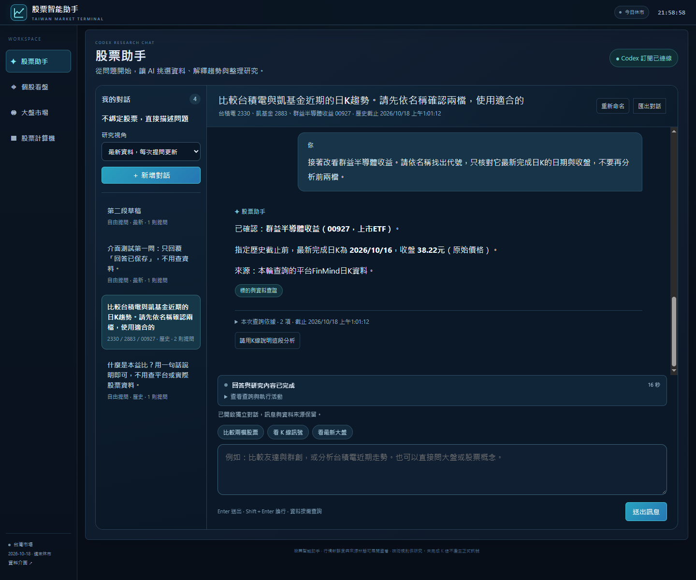

Codex依問題按需呼叫看盤、技術、財務、籌碼、同業、新聞及大盤工具。每個Session獨立接續，需要時產出可下載報告與日K引導，詳見[功能設計](docs/FEATURES.md#股票助手)。本機安裝與訂閱登入見[本機 AI Agent](#本機-codex-cli-與-ai-agent)。

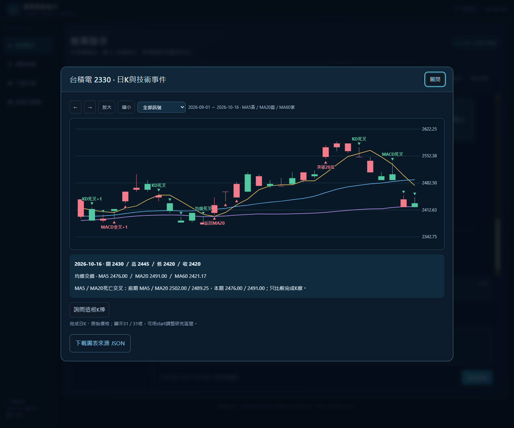

### 台股看盤工作台

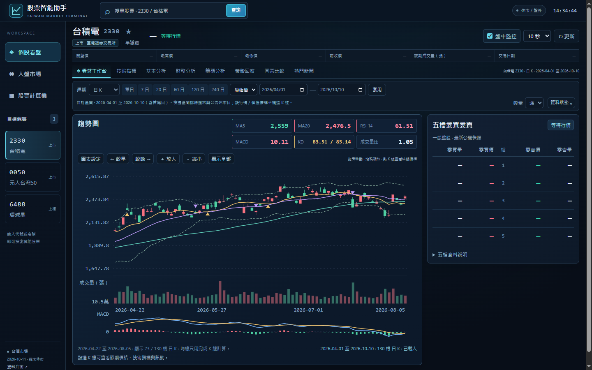

### 加權指數與台指期

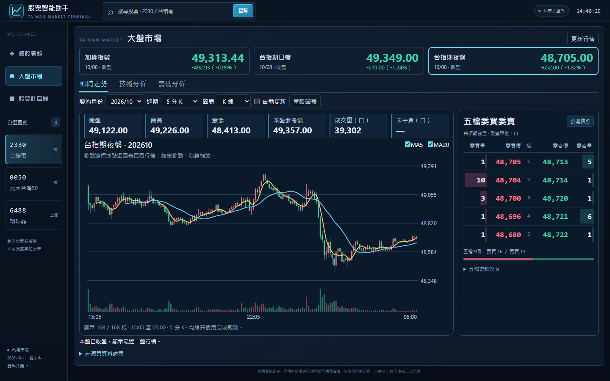

### 大盤籌碼與公司新聞

| 大盤籌碼                                                                              | 公司新聞與公開討論                                                            |
| ------------------------------------------------------------------------------------- | ----------------------------------------------------------------------------- |
| 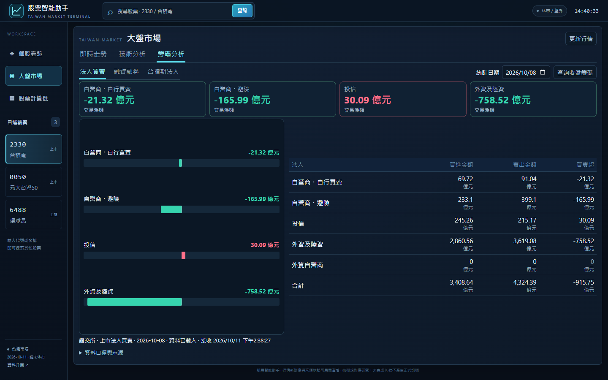 | 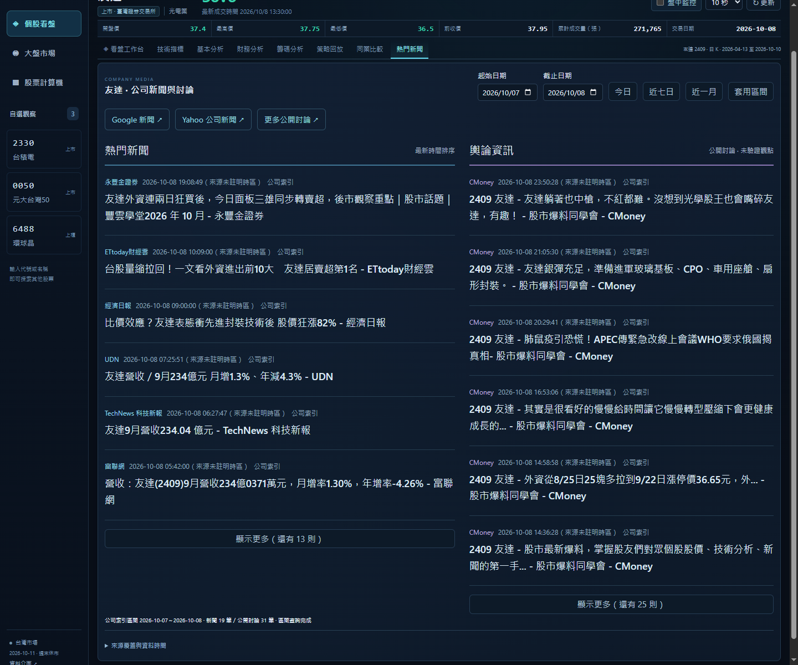 |

主菜單切換「股票助手／個股看盤／大盤市場／股票計算機」，內容在同一頁中央更新。股票計算機為獨立工具頁，可透過頂部搜尋選取股票，不顯示個股行情與研究分頁。個股的「熱門新聞」位於同業比較旁；大盤分為即時走勢、技術分析與籌碼分析。

大盤桌機版依視窗高度配置走勢、五檔、技術卡片與籌碼明細，已核對1280×720至1920×1080等常見尺寸同屏可見。大盤五檔與個股共用欄位、字體、紅綠配色、深度色帶與委託合計；期貨數量以口表示，代表尚未成交的委託契約數。排版驗證可執行 `npm run verify:market-layout`。

| 財務分析                                                                                      | 財務歷史趨勢                                                                                   |
| --------------------------------------------------------------------------------------------- | ---------------------------------------------------------------------------------------------- |
| 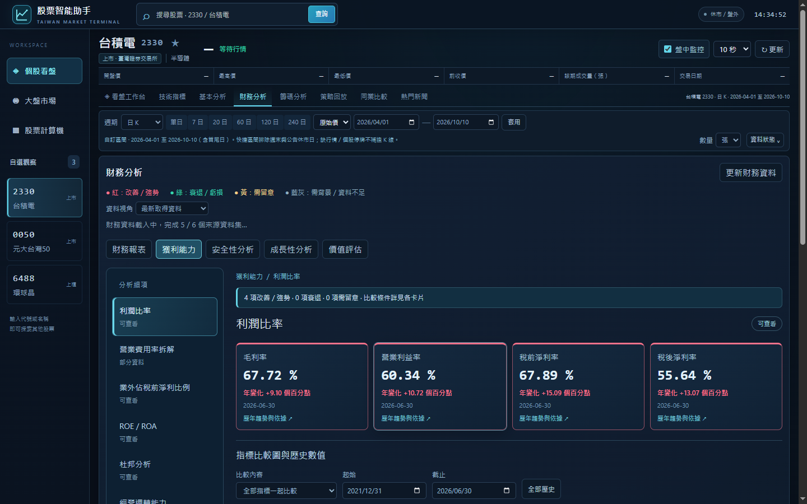 | 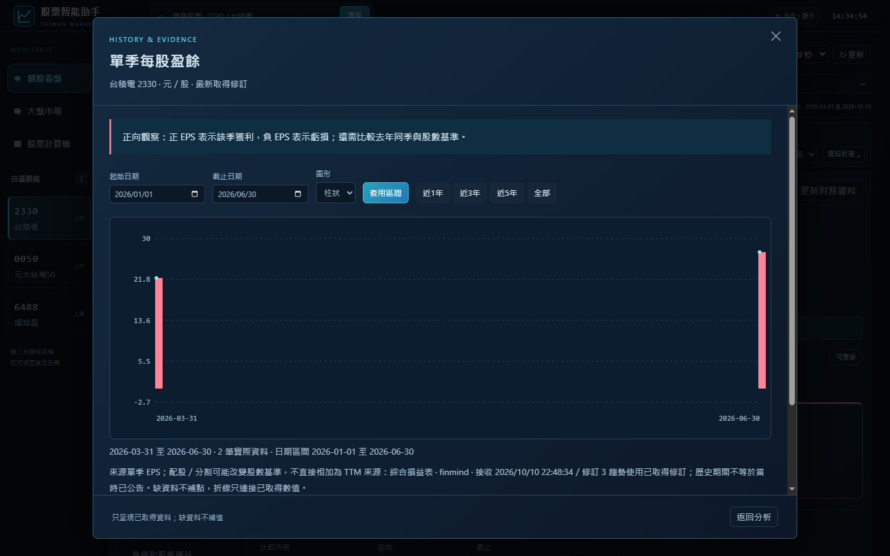 |

| 股票計算機                                                                                  | 同業比較                                                                                     |
| ------------------------------------------------------------------------------------------- | -------------------------------------------------------------------------------------------- |
| 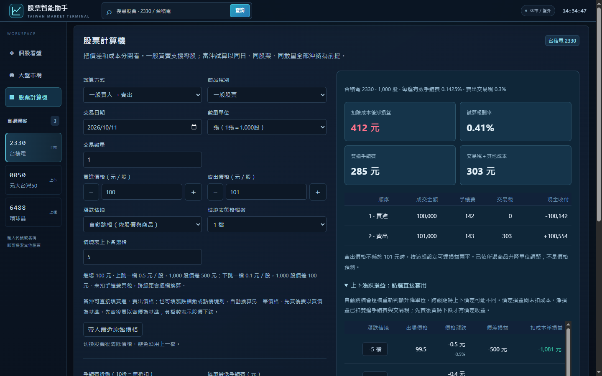 | 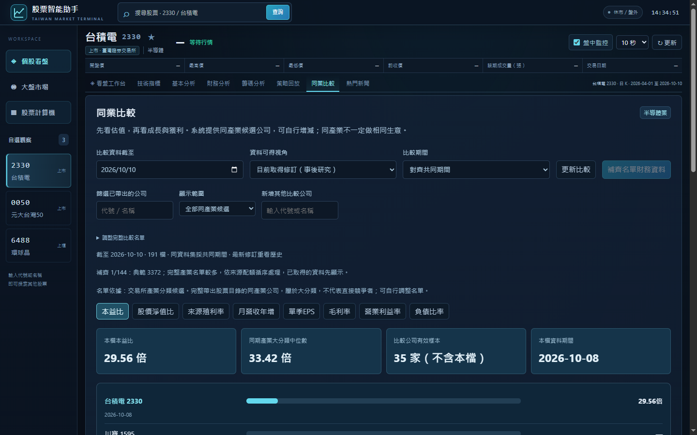 |

截圖存於 `web/public/images/screenshots/`，建置時由前端複製至 `dist/images/`。

## 功能與資料覆蓋

個股籌碼提供九個子頁：法人買賣、主力進出、券商分點、籌碼分布、大戶散戶、融資融券、董監持股、申報轉讓、ETF／基金持股。主圖與明細依選定區間切換；股／張顯示共用。已接入個股資券及上市／上櫃官方揭露，主力與分點的會員來源、基金覆蓋及歷史資料限制見[個股籌碼工作區](docs/FEATURES.md#籌碼分析)。

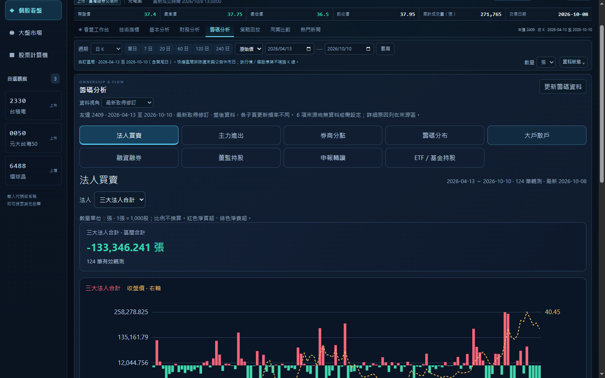

執行 `npm run verify:chips` 可驗證九子頁、門檻切換、日期區間、股張換算與響應式排版。

| 模組           | 1.2.0 功能                                                                           | 可用性與限制                                                                                                  |
| -------------- | ------------------------------------------------------------------------------------ | ------------------------------------------------------------------------------------------------------------- |
| 看盤與歷史行情 | 股票搜尋、自訂起訖日、分鐘／小時／日／週／月 K、拖曳縮放、數量單位與均線開關         | 日線依來源可得性；分鐘線需相應 FinMind 權限                                                                   |
| 公開行情與五檔 | 公開報價快照、五檔、來源時間及行情新鮮度                                             | 非逐筆串流；歷史回看不拿現在五檔代替                                                                          |
| 技術分析       | MA5／10／20／60／120／240、RSI、MACD、KD、ATR、布林通道、量比與完成 K 線訊號         | 需足夠完成 K 線及暖機資料；缺值不補零                                                                         |
| 大盤市場       | 獨立主菜單、即時走勢、歷史技術指標、上市法人／融資融券、台指期法人、期貨日夜盤五檔   | 指數沒有委託五檔；籌碼為收盤日統計；期貨不拼接契約，指數日線只用官方收盤值                                    |
| 公司媒體       | 公司新聞、右側公開討論、起訖日期、今日／近七日／近一月、逐日進度、來源狀態與更多文章 | 公司索引逐日合併，單次最多31日；Yahoo／PTT只涵蓋近期RSS，歷史不完整；Google RSS需符合個人非商業條件後自行啟用 |
| 基本分析       | 公司資料與機構研究資料介面                                                           | 股利在財務分析；法人目標及研究報告需授權資料，並非內建完整覆蓋                                                |
| 財務分析       | 財務報表、獲利能力、安全性、成長能力、價值評估五類共 38 細項導覽；歷史圖表與表格     | 選單已實作；部分指標、河流圖等仍缺必要資料，詳見[內容核對](docs/FEATURES.md#財務內容與差異)                   |
| 籌碼分析       | 法人流量、分點代理、股權分布、ETF／基金持股與股／張換算                              | 依來源與權限；免費集保資料僅最新週，歷史需累積；不推測交易者身分                                              |
| 股票計算機     | 買入、賣出、當沖、零股、折扣、最低手續費、稅、損益及損益兩平；跨級距跳檔             | 費用用十進位計算；不判定帳戶是否可當沖，不含融資融券                                                          |
| 同業比較       | 完整產業候選、業務相近組、共同期間、中位數、缺漏與過期資訊                           | 同產業不代表直接競爭；資料不足會明示                                                                          |
| 策略回放       | 個股策略回放頁、次根開盤成交假設、成本與來源修訂                                     | **實驗性研究功能**；賣出稅預設 0，須自行設定，不模擬實盤成交限制                                              |
| 預測 API       | 還原日線 ridge 五期預測、滾動評估及基準誤差                                          | **僅 API，尚無前台預測頁**；至少165根完成還原日線，預設未啟用還原擷取                                         |
| 資料工作       | 持久佇列、按需回補、自選股排程、限流重試、心跳與中斷恢復                             | 仍受來源配額、服務狀態與會員方案限制                                                                          |

### 資料契約

- 股票代號使用字串，保留 `0050` 等前導零。
- 原始價與還原價分開；整股與零股交易類型分開。
- 成交量統一儲存為股，畫面按功能換算為張。
- 分鐘線使用具時區時間戳，日線另存交易日期；顯示採 `Asia/Taipei`。
- 行情具唯一鍵，重跑不新增重複正式資料；更新前保留修訂。
- 未完成 K 線明確標示，正式訊號只使用完成 K 線。
- 財務及同業比較核對共同期間、來源、接收時間與必要科目。

## 系統架構

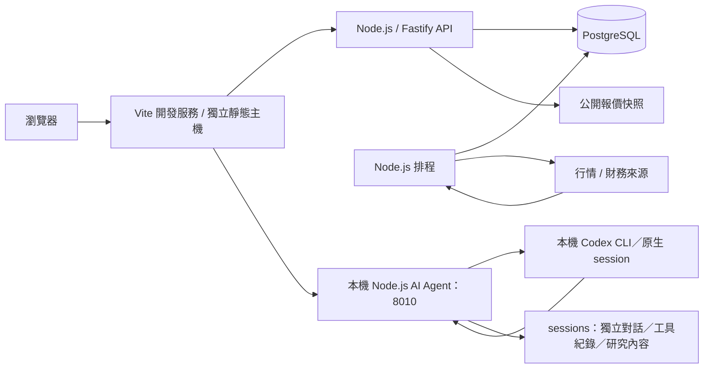

| 層級     | 技術與部署方式                                             |
| -------- | ---------------------------------------------------------- |
| 前端     | Vite 8、ES modules、Bootstrap 5、JavaScript MVC、SVG 圖表  |
| API      | Fastify 5、OpenAPI、JSON API；不提供股票工作台檔案         |
| 工作程序 | Node.js、PostgreSQL 工作佇列、排程與來源限流               |
| 資料庫   | PostgreSQL 17、SQL 遷移、行情唯一鍵與修訂                  |
| 計算     | 原生 JavaScript 指標／財務計算、decimal.js 費用運算        |
| 後端部署 | Compose：`postgres`、`api`、`scheduler`                    |
| AI Agent | 本機 `npm run assistant:start`，呼叫已登入訂閱的 Codex CLI |
| 前端部署 | 獨立靜態主機，透過同源反向代理連接 API                     |

API 的 `/docs` 保留自己的文件頁與 Swagger 資源；股票頁面、圖片、CSS 與前端原始碼由前端服務管理。

### 專案結構

```text
TWStock-Coach/
├── api/                 # Node.js API、分析、資料來源、工作與 SQL 遷移
├── agent/               # 訂閱Codex、研究工具、skills與Session保存
├── sessions/            # 獨立Chat對話與研究內容，不提交版本控制
├── reports/             # 舊報告封存，僅讀取／下載
├── web/
│   ├── index.html       # Vite 入口
│   ├── src/             # MVC 模組、樣式與啟動程式
│   ├── public/images/   # README 截圖
│   ├── deploy/          # 獨立前端反向代理範例
│   ├── vite.config.js   # 開發／預覽服務與 API 代理
│   ├── package.json     # 前端版本與指令
│   └── dist/            # 建置產物，不提交版本控制
├── scripts/             # 設定與服務／瀏覽器驗證
├── tests/               # API 邊界回歸測試
├── docs/                # 架構設計與功能設計（兩份）
├── compose.yaml         # 後端服務
├── Dockerfile           # 獨立 API／排程映像
├── CONTRIBUTING.md      # 貢獻流程
└── LICENSE              # MIT 授權
```

## 設定

| 變數                       | 用途                         | 預設或範例                                                                   |
| -------------------------- | ---------------------------- | ---------------------------------------------------------------------------- |
| `POSTGRES_PASSWORD`        | Compose 資料庫密碼           | setup 產生                                                                   |
| `INGEST_API_KEY`           | 授權匯入的 `X-API-Key`       | setup 產生，不傳至前端                                                       |
| `FINMIND_TOKEN`            | FinMind 會員權限             | 選填，依資料項目需相應方案                                                   |
| `WATCHLIST`                | 定期更新清單，不限制前台搜尋 | `TWSE:2330,TWSE:0050,TPEX:6488`                                              |
| `BACKFILL_START`           | 首次日線回補起日             | `2021-01-01`                                                                 |
| `ENABLE_ADJUSTED`          | 另外擷取還原價               | `false`                                                                      |
| `FINMIND_REQUEST_INTERVAL` | 來源請求間隔秒數             | `8`，最低 `1`                                                                |
| `ETF_WATCHLIST`            | 指定主動 ETF                 | 選填，最多 10 檔                                                             |
| `GOOGLE_NEWS_ENABLED`      | Google 新聞 RSS 個人閱讀     | `false`；第三方用途限制見[公司媒體設計](docs/FEATURES.md#熱門新聞與公開討論) |
| `API_PROXY_TARGET`         | Vite 開發／預覽的 API 目標   | `http://127.0.0.1:8000`                                                      |
| `ASSISTANT_ACCESS_KEY`     | 平台 AI 功能存取密碼         | `npm run assistant:setup` 產生，不是 OpenAI API Key                          |
| `CODEX_BIN`                | 本機 Codex CLI 執行檔        | 預設 `codex`；Windows 可指定原生 `codex.exe` 完整路徑                        |
| `ASSISTANT_PORT`           | 本機 Agent 連接埠            | `8010`                                                                       |
| `ASSISTANT_SESSION_DIR`    | Chat對話與研究快照保存目錄   | `sessions`                                                                   |
| `ASSISTANT_REPORT_DIR`     | 舊報告封存目錄（僅讀取）     | `reports`                                                                    |
| `ASSISTANT_MODEL`          | CLI 使用的模型               | 留空沿用 CLI 預設，須為訂閱帳號可用模型                                      |
| `ASSISTANT_PROXY_TARGET`   | Vite 的 Agent 代理目標       | `http://127.0.0.1:8010`                                                      |

修改股票服務 `.env` 後執行 `docker compose up -d api scheduler`；修改本機 Agent 設定則停止並重新執行 `npm run assistant:start`。兩項 Vite 代理目標由啟動程序的環境變數讀取，修改後重啟 Vite；設定方法見[架構設計](docs/DESIGN.md#前端開發與預覽)。

## 部署

**後端**：`docker compose up -d --build`。映像只包含 API、排程與驗證工具，不建置或打包 `web/dist`。

**前端**：`npm run build`，將 `web/dist` 部署至獨立靜態主機。主機需將 `/api`、`/docs`、`/health` 與 `/openapi.json` 代理至 API，保留完整路徑與查詢參數；提供 [Nginx 範例](web/deploy/nginx.conf)。純靜態檔案託管仍需另配置 API 代理或閘道。

**AI Agent**：在本機執行 `npm run assistant:start`，與股票容器分開管理。啟用 AI 時，反向代理須優先將 `/api/assistant` 送至 Agent 的 8010，其餘 `/api` 送至股票 API 的 8000；Vite 開發／預覽已配置這個分流。Compose 僅管理 `postgres`、`api`、`scheduler`。

API 預設綁定本機 `8000`，正式對外 HTTPS、程序管理及備份方式見 [部署與維護](docs/DESIGN.md#部署與維護)。`docker compose down -v` 會刪除資料卷，更新時應保留資料庫。

## 維護與驗證

```sh
npm test                 # API 隔離回歸測試，無需資料庫或行情來源
npm run format:check
npm run build
npm run verify           # 運行中的 API、資料庫與既有行情檢查
docker compose exec -T api npm run verify:worker  # 排程鎖、執行心跳與佇列
npm run verify:browser   # 預設驗證 5173 前端，需 Compose、Vite 與 Chrome
npm run verify:market
npm run verify:market-layout
npm run verify:chips
```

目前工作區 `npm test` 有 **35 項測試**，包含Session隔離、原生thread接續參數、SSE即時文字／權限／斷線續接／停止、資料工具、使用者成本與損益維度、K棒技術事件及前端資料規則。另已透過訂閱Codex實測獨立Session、接續與報告／K線工具，並用真實瀏覽器驗證Chat互動及1440／1024／390／320寬度。`verify:assistant`會建立測試對話並消耗訂閱額度；`verify:assistant-browser`使用前者保存的Session，會新增介面測試對話與訊息。詳見[架構設計](docs/DESIGN.md#驗證與維護)。

`API_BASE_URL` 可指定 API 驗證位址；`WEB_BASE_URL` 可讓服務驗證同時檢查前端。`BASE_URL` 用於瀏覽器驗證，例如改測 `4173` 建置預覽。

手動資料工作：

```sh
docker compose run --rm api node api/cli.js sync --start 2026-01-01 --end 2026-09-30
docker compose run --rm api node api/cli.js fundamentals
```

## 貢獻與授權

歡迎透過 Issues 提供可重現的問題與功能建議，或提交 Pull Request。請先閱讀 [CONTRIBUTING](CONTRIBUTING.md)，附上變更目的、驗證方式與資料口徑。

程式碼依 [MIT License](LICENSE) 授權。Bootstrap 等第三方程式保留各自授權；行情與財務資料須遵循原始來源的使用及轉載條件，MIT 不授予第三方資料權利。

## 專案文件

| 文件                         | 內容                                                                 |
| ---------------------------- | -------------------------------------------------------------------- |
| [架構設計](docs/DESIGN.md)   | 模組邊界、資料契約、Compose／Agent 啟動、部署、備份與驗證            |
| [功能設計](docs/FEATURES.md) | 看盤、財務、籌碼、同業、新聞、大盤、計算機及 AI 報告的現行設計與限制 |
