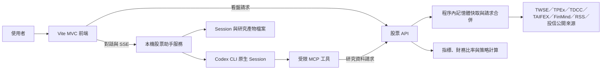

# 架構設計

更新：2026-11-24 · 套件版本：1.2.0

本文件說明整體架構、服務邊界、資料流、儲存與部署。功能規格、股票助手工具／技能、分析方法、API 對照與資料缺漏統一維護於 [FEATURES.md](FEATURES.md)，此處不重複列出。

## 文件分工

| 文件                    | 閱讀目的                             | 內容界線                                                  |
| ----------------------- | ------------------------------------ | --------------------------------------------------------- |
| [README](../README.md)  | 認識專案與開始使用                   | 功能摘要、啟動指令、設定入口及預覽                        |
| 本文件                  | 理解系統如何組成與運作               | 服務分工、模組分層、請求流程、儲存、快取與部署            |
| [功能設計](FEATURES.md) | 查功能能做什麼、如何分析及有哪些限制 | 個股八區塊、來源／API、助手工具與技能、提問範例及驗證結果 |

## 系統總覽

平台由前端、股票 API 與選用的本機股票助手三個獨立服務組成。前端採 Vite／Bootstrap／JavaScript MVC，後端採 Node.js／Fastify；股票資料由來源 API 按需取得，再於平台計算衍生指標。

看盤與助手共用股票 API。助手不另外建立行情資料庫，也不自行維護另一套技術指標。**股票資料沒有 SQL 讀寫、資料庫驅動、初始化 SQL、資料遷移或持久收集排程。**

## 服務與部署邊界

| 元件      | 預設位置                 | 執行與責任                                                             |
| --------- | ------------------------ | ---------------------------------------------------------------------- |
| 前端      | Vite `5173`；預覽 `4173` | 獨立啟動，負責畫面、互動與呈現；正式產物為 `web/dist`                  |
| 股票 API  | `8000`                   | Compose 管理 `api`；統一取得來源、驗證、快取及計算，不提供前端靜態頁面 |
| 股票助手  | 本機 `8010`，選用        | 獨立 Node.js 服務，啟動 Codex CLI、管理對話及串流；不加入 Compose      |
| Codex CLI | 由助手按需啟動           | 使用 ChatGPT 訂閱登入與原生 agent loop，不使用模型 API Key             |
| 外部來源  | 來源網站／API            | 提供行情與揭露，受權限、額度、日期覆蓋及服務可用性限制                 |

開發時 Vite 將 `/api/assistant` 代理到助手，其餘股票 API 請求送到股票 API。正式部署由網站伺服器提供 `web/dist`，再分別反向代理兩項後端服務；Vite 開發伺服器不作為正式部署方案。

股票 API 與 Codex 是兩項獨立依賴：模型登入成功不表示資料服務可用。未啟動助手時仍可看盤；股票 API 離線時助手不能取得行情，但可回答不需市場資料的概念問題。

## 請求與資料流

### 個股與大盤看盤

1. 使用者選擇標的、區塊或期間，前端向股票 API 發送對應請求。
2. API 驗證參數，查詢程序內資源；相同請求共用正在進行的來源工作。
3. 有有效快取便回傳；否則按需取得來源，保留來源時間與實際資料日。
4. 平台計算指標、比率或回放結果，回傳資料與來源狀態。
5. 尚未完成的來源可先回傳部分結果，前端再查同一資料入口取得新進度。

選定股票不會建立 DB 收集工作。離開區塊會停止前端輪詢與後續批次；已送出的共享來源請求可能繼續完成，供其他請求重用。

區塊與接口對照見[個股看盤資料入口](FEATURES.md#個股看盤資料入口)；資料狀態與缺漏定義見[共通資料規則](FEATURES.md#共通資料規則)。

### 股票助手對話

使用者訊息由助手服務交給對應的 Codex Session；Codex 透過受限工具查詢同一股票 API，回答文字與查詢活動以 SSE 回到前端，必要時產生圖表或報告並隨 Session 保存。平台保留原生 agent loop，不另建固定的模型迴圈。

助手的工具、技能、分析方法、執行參數及實作對照統一見[股票助手功能設計](FEATURES.md#股票助手)。本文件只保留助手在系統中的位置與服務邊界。

## 程式分層與目錄

| 層級         | 主要位置                                                     | 責任                                                  |
| ------------ | ------------------------------------------------------------ | ----------------------------------------------------- |
| 前端 MVC     | `web/src/models`、`controllers`、`views`、`styles`           | 資料呼叫、畫面狀態、圖表與互動                        |
| HTTP 與契約  | `api/api.js`、`api/contracts.js`                             | 路由、參數驗證、OpenAPI 與錯誤回覆                    |
| 資料組裝     | `api/direct-data.js` 與各資料領域模組                        | 組成看盤回應，保留可用性與來源資訊                    |
| 來源連線     | `api/providers.js` 與官方／投信來源模組                      | 取得及正規化行情、報表、股權與基金資料                |
| 共用資源控制 | `api/source-cache.js`、`source-queue.js`、`source-budget.js` | 有界快取、請求合併、排隊、額度與失敗冷卻              |
| 分析計算     | `api/indicators.js`、財務、技術事件與策略模組                | 執行可重現計算，不由語言模型編造數字                  |
| 助手服務     | `agent/`                                                     | Codex 橋接、Session、工具、串流及產物；細節見功能文件 |
| 維護與查核   | `scripts/`、`agent/tests`、`web/tests`                       | 環境設定、程式測試、來源查核與整合驗證                |

資料組裝與計算模組不含 SQL 備援；必要讀取器未設定時回報錯誤，不嘗試改讀資料庫。舊研究接口保留相容用途，現行 Chat 不依賴舊整包報告流程。

## 儲存與時間邊界

| 資料類型                       | 保存位置                             | 生命週期與用途                                           |
| ------------------------------ | ------------------------------------ | -------------------------------------------------------- |
| 股票行情、財務、籌碼與來源回應 | API 程序記憶體                       | 有期限與容量限制；API 重啟後清除，不從 DB 或歷史檔案還原 |
| 技術指標、比較與回放結果       | 依來源計算及程序資源                 | 不另建持久股票資料層，不能當成完整歷史快照庫             |
| 對話、引用與研究產物           | `sessions/`；舊報告封存於 `reports/` | 保存脈絡與當次產物，不作為股票行情快取                   |
| 驗證輸出                       | `.tmp/`                              | 診斷與查核紀錄，不讀回作為股票來源                       |

可回看來源目前提供的歷史序列，但不能重建歷史當時已公布、已接收的完整版本。報表期末、行情時間與平台接收時間是不同概念；詳細價格、期間及判讀規則見[功能文件](FEATURES.md#共通資料規則)。

## 快取、排隊與失敗隔離

- **有界且可重用**：依資源類型與日期設定快取期限，相同請求合併；不使用持久工作佇列。
- **共用來源預算**：同一 API 程序共用節流與滾動額度，重試亦計入預算；多程序部署需分配或共享限制。
- **前景優先**：正在查看的資料優先於背景補齊；成功部分保留來源時間，失敗部分依冷卻規則重試。
- **漸進呈現**：長區間與多來源允許部分完成；畫面切換速度與來源完成時間分開評估。
- **錯誤可辨識**：服務離線、來源逾時、權限不足、空資料與計算條件不足分開，不以零值補齊。

API `/health` 提供程序、資料模式及來源活動狀態；助手另回報模型與股票 API 的連線狀態。健康檢查成功只表示可連線，不代表每個上游資料集完整或最新。外部來源失效時不回退到舊 DB。

## 啟動與相容

依 [README 快速開始](../README.md#快速開始)啟動前端與股票 API；需要對話再啟動[本機股票助手](../README.md#本機-codex-cli-與-ai-agent)。環境參數與埠位以 README 及程式設定為準，不在兩份文件重複維護完整指令。

Compose 僅包含股票 API。一般看盤不使用 `INGEST_API_KEY`；舊匯入／工作接口保留停用相容回應，沒有可執行的 DB 工作。既有 Session、報告及歷史資料卷不因一般更新而自動刪除，也不作為股票服務的執行依賴。

## 驗證入口

| 檢查       | 指令與目的                                                             |
| ---------- | ---------------------------------------------------------------------- |
| 程式與建置 | `npm test`、`npm run build`、`npm run format:check`                    |
| 看盤整合   | `npm run verify`、`npm run verify:browser`：檢查實際接口、回放與畫面   |
| 來源覆蓋   | `npm run audit:data`：區分可用性、權限與缺項                           |
| 助手工具   | `npm run verify:assistant-tools`：對實際 API 查核註冊工具，不呼叫模型  |
| 真實對話   | `npm run verify:assistant`：使用本機訂閱 Codex 檢查 Session 與研究產物 |

來源查核會消耗請求額度，模型對話查核會使用訂閱額度。工具定義、計算、來源格式與畫面屬不同驗證面向，不能以單一測試通過宣稱全部完成。已完成的查核結果與限制集中於[功能文件](FEATURES.md#驗證與資料查核)。
