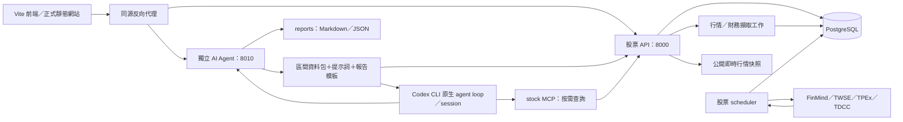

# 架構設計

更新：2026-10-18，版本1.2.0。平台後端使用 Node.js ES modules；AI 分析另呼叫 Codex CLI，不依賴 Python 後端。前端使用 Vite、Bootstrap 與 ES modules MVC；開發服務及正式靜態網站均獨立於API。Fastify不提供看盤前端。



## 文件範圍

本文件維護系統邊界、資料契約、啟動部署、備份及驗證。畫面操作、指標細項與資料不足的呈現方式集中於[功能設計](FEATURES.md)。不保留舊版架構或歷次測試數字作為現行規格。

| 服務      | 啟動方式                                    | 狀態保存                                |
| --------- | ------------------------------------------- | --------------------------------------- |
| web       | 本機 Vite；正式部署 web/dist                | 瀏覽器畫面設定                          |
| api       | Compose api／node api/index.js              | PostgreSQL                              |
| scheduler | Compose scheduler／node api/cli.js schedule | PostgreSQL 股票工作佇列                 |
| agent     | 本機 npm run assistant:start                | reports 檔案及本機 Codex 認證／會話目錄 |

Agent 是常駐 Node.js 橋接服務；Codex CLI 僅在分析或追問時啟動。Agent 不連資料庫；前端先從 POST /api/research/report-input 建立畫面基準，再提交給 Agent。Agent 依股票、分析起日與截止重新查詢 API，先提交各面向資料、問題與模板，不使用客戶端數值代替實際查詢。Codex 可透過 stdio MCP 工具補查細節。CLI 使用原生 agent loop，平台不另建一套分析循環。AI 服務最多執行一個 CLI 子程序，忙碌時拒絕新工作，不建立持久佇列。

## 程式責任

股票排程與 AI Agent 各有獨立責任。下表對應目前程式位置；AI 報告操作與檢核見[功能設計](FEATURES.md#ai-分析報告)。

研究報告由 `report-observations.js` 統一商品／產業口徑、法人日期及技術觀測，`report-conditions.js` 產出固定策略與逐項檢核。`agent/AGENTS.md` 維護共同規則，`agent/templates/report-template.md` 定義輸出結構，`report-input.js` 預先整理資料，`agent/tools.js` 封裝既有 API，`mcp-server.js` 使用官方 MCP SDK 提供工具。CLI 自主呼叫 stock 工具；shell、搜尋與其他 MCP 禁止，不另開第二套 agent loop。新規則只影響新報告，既有 Markdown／JSON 與 session 保留原輸入和版本，不回寫過去報告。

| 位置                                                              | 責任                                                     |
| ----------------------------------------------------------------- | -------------------------------------------------------- |
| api/index.js、api.js、contracts.js                                | 啟動、路由、驗證、API文件及文件專用資源                  |
| api/config.js、db.js、migrations                                  | 環境、連線池、交易與可重跑 SQL 遷移                      |
| api/service.js                                                    | 行情驗證、唯一資料、修訂、完成資料分析與查詢             |
| api/providers.js、market.js、trading.js                           | 來源限流重試、公司／集保／ETF、股票目錄、五檔、交易日曆  |
| api/jobs.js、cli.js                                               | 持久工作排隊、心跳、恢復、排程及一次性命令               |
| api/indicators.js、charting.js                                    | 技術指標、先暖機後截取區間、多週期聚合與正式訊號         |
| api/fundamentals.js、financial-metrics.js、financial-catalog.json | 財務期間、科目映射、缺值、歷史趨勢與38細項               |
| api/equity.js、peers.js                                           | 籌碼分布／流量、來源覆蓋、授權揭露、產業候選與同期間比較 |
| api/calculator.js                                                 | decimal.js 費用、稅、損益兩平與跨級距跳檔                |
| api/market-board.js、market-chips.js                              | 大盤行情、期貨日夜盤、上市法人與融資融券、來源日期與快照 |
| api/media.js                                                      | 公司新聞索引、RSS／Atom、公開討論、關聯與去重            |
| api/strategy.js、research.js                                      | 可追溯研究規則、次根成交回放、滾動 ridge 預測            |
| api/research-packet.js、report-conditions.js                      | 固定研究資料包、歷史截止與完成日線條件，不啟動 Codex     |
| agent/index.js、server.js、codex-adapter.js、report-store.js      | 獨立 HTTP 橋接、訂閱 CLI、原生 session 與檔案報告        |
| web/src/models、views、controllers                                | 前端狀態、DOM／SVG呈現、互動與請求取消                   |
| web/src/views/orderbook-view.js                                   | 個股與期貨共用五檔、深度色帶、缺值與委託合計             |

Agent以GET /api/assistant/reports/:id/events提供SSE進度。Codex --json事件先轉成有限的活動資訊，不轉送推理、提示詞或原始工具資料；正式結果經驗證後才保存。SSE重連可續接，活躍報告由記憶體提供即時狀態，階段及終態隨檔案保存。每10秒發送心跳，代理須關閉回應緩衝；完成、取消、失敗及服務關閉時清理連線。

## AI 工具邊界

每次 CLI 啟動建立暫存研究工作目錄，複製 `AGENTS.md`，並透過執行參數註冊唯一的 `stock` stdio MCP。工具不接受任意 URL、SQL、股票代號或截止時間；自動模式可傳start選擇截止前一年內起日，手動模式禁止更改起日，股票與截止由服務注入，API 位址由 `ASSISTANT_STOCK_API_URL` 管理。工具僅使用既有研究資料、財務與籌碼查詢功能，不暴露匯入、擷取排程、下單或任意命令。MCP 程序隨 CLI 的 stdin 關閉停止。

`get_stock_data` 的各面向在同一次執行共用 API 研究快照，避免跨工具時間漂移；完整財務與籌碼子頁再按需呼叫既有 GET 路由。日K指標重用 `api/indicators.js`，先暖機再截取區間。AI分析前準備資料時，將已取得的區間明細完整提交，不因前台或工具分頁只取第一頁。模型補查仍保留分頁：技術從最新往回查，財務歷史與籌碼明細從第一頁往後查，均返回總筆數與下一頁狀態。來源缺漏仍明示，輸入超出上限會要求縮小區間，不悄悄截斷。來源修訂明細完整保存，但不重複送入模型。

工具事實使用每次查詢專屬的證據 ID，追問不會引用到同名的舊數值。模型輸出的引用與金額只對本次成功查詢驗證；未查資料的回答不保存為完成分析。查詢成功與失敗均隨報告 JSON 保存，取消或執行失敗也保留已完成的查詢紀錄。原始圖表／條件與後續回答的查詢時點分別保存，不覆寫舊報告。

產業欄位使用股票目錄的實際值，不另由 API 正規表示式二分或附上固定財務結論。研究資料的 `financial:coverage` 保存本次查詢是否成功、來源覆蓋及每项指標的可用性；產業分析由報告模板與AI依實際產業判讀，缺漏敘述需核對本次工具結果。新報告不再包含 `sectorProfile` 的 `focus`／`limitation`。

## 儲存契約

加權指數與台指期由api/market-board.js提供獨立行情及歷史區間，來源快照存於market_board_snapshots，不與股票股數混用；盤別、契約及暖機設計見 [市場看板](FEATURES.md#大盤市場)。

股票代號為字串，保留0050等前導零。量一律存股，37股不截斷；來源張／股單位另外保存。原始與還原價分序列，零股及整股交易類型分開。

bars 的唯一鍵為市場、商品、交易類型、週期、價格基準、具時區時間戳，不含來源；同鍵不同來源回報衝突，不自動切換。日線另外保存交易日期，時間戳採台北13:30；分鐘要求整分鐘。顯示使用 Asia/Taipei。

重跑同內容不增加修訂；更動前保存完整舊 snapshot。舊來源時間及已完成降回未完成皆忽略。行情更新及指標重算在同一交易提交，analysis 只對應目前 bar_revision；未完成資料無正式指標。PostgreSQL 交易鎖序列化寫入。

財務／籌碼快照不可變，保留 dataset、source、received_at、digest、revision、data。重跑依正規化內容及來源去重，也可沿用遷移前 digest。歷史可得性依平台接收時間，財報期間不冒充公告時間；現在取得的舊財報不回填為當年已知。公開報價快照另存 quote_snapshots，不能拼成假的 OHLC。

## 排程與來源

API 將按需回補存入 job_runs，202回應提供工作ID。缺分鐘Token會立即記錄失敗原因，不排隊等待其他來源；相同請求沿用工作，日K仍可使用。等待與執行中的工作不受完成工作快取期限限制，等待時間不能當成失敗心跳。互動工作上限為行情6、籌碼3、財務4；priority=0 的自選排程不占互動名額。Node.js scheduler 每秒檢查，依互動行情、互動分析、定時更新的優先順序claim；使用行鎖，執行程序另持有 schema 專屬 advisory lock，確保同一 schema 只有一個來源消費者。心跳每30秒，中斷恢復最多3次嘗試；只有取得排程鎖的工作程序可恢復 running 工作。來源失敗不等於自動恢復重試，FinMind 請求本身另有4次重試。CLI 可以處理工作；有其他消費者時等待既有工作結果。

每六小時排程 WATCHLIST 日線與財務更新。日線首次從 BACKFILL_START 開始，後續重疊最近10個日曆日抓修正，不重新抓全部。使用者歷史區間另有至少420日暖機；週／月長均線可增加至8000日，分鐘14日。日期輸入、顯示區間、來源實際有資料的期間分開。

所有 FinMind 請求共用程序內限流、45秒來源逾時與最多4次重試；429／5xx退避。工作失敗保留原因，不使用推估值填空。公司及集保快取24小時、MIS10秒、交易日曆1小時。公開行情不可保證即時或完整五檔。

## 計算與限制

MA、Wilder RSI／ATR、MACD、KD、布林通道及量比在所選完成觀測上計算。先取暖機、聚合，再截取顯示範圍。週／月 K 必須區間結束且所有已取得成分完成才標正式；完成不保證無缺漏。窗口以有效觀測計數，不補停牌／無成交為零。一般分鐘以09:00、盤中零股以09:10開始聚合；盤後零股14:30的單次撮合另成一根，不套用一般交易時段。自動分鐘擷取仍只接一般整股，零股分鐘需授權匯入，前台尚無零股行情切換。

費用使用 decimal.js，元以下處理可追溯；API金額是字串。財務要求同期間與連續季，缺必要科目保留null；不以相近科目硬替代。預測僅使用完成還原日線，標準化與訓練標籤只使用當時已完成資料，回傳基準誤差與殘差範圍，不提供交易指令。

目前適合個人自選股規模。大量分鐘線仍需分區、增量重算及正式串流來源；公開快照不替代授權盤中行情。股票資料與數值計算不依賴語言模型；只有 AI 報告及追問使用 Codex 訂閱額度。

## 前端工作流程

主菜單為 AI 分析報告、個股看盤、大盤市場、股票計算機，桌機側欄與手機頂部同步切換中央內容。大盤與計算機不顯示個股行情列、研究導覽及個股日期控制。計算機仍可使用頂部搜尋或自選股選取商品。歷史行情位於技術指標下方，預設收合。策略回放有個股分頁；預測目前只有 API，沒有前台頁面或獨立預測排程。

`web/index.html` 是 Vite 入口，`web/src/main.js` 匯入樣式與模組，待模組完成載入後依序執行 DOM 綁定。Model、View、Controller 以明確 import/export 連接；共用可變狀態由物件管理，避免修改唯讀的匯入綁定。

根目錄 `npm run dev` 或在 web 執行同名指令，啟動127.0.0.1:5173；/api/assistant 優先代理至 ASSISTANT_PROXY_TARGET（預設http://127.0.0.1:8010），其餘 /api、/health、/docs、/openapi.json代理至API_PROXY_TARGET（預設http://127.0.0.1:8000）。這個設定只供開發工具使用，不將.env金鑰放入前端。Vite preview位於4173，僅供本機預覽。

`npm run build` 產出web/dist；圖片由web/public/images複製至dist/images，程式與樣式建置為assets下的內容雜湊檔。正式前端由獨立靜態網站服務提供，透過反向代理連接API；Nginx範例在web/deploy/nginx.conf。目前 Compose 管理 postgres、api、scheduler，AI Agent 與 Vite 在本機另行啟動。

API根路徑回傳服務名稱、版本及文件／健康路徑的JSON。工作台、前端原始碼及圖片路徑在API回應404；Swagger的/docs及其專用資源仍可使用。版本取自根package.json，與OpenAPI同步。MIT授權適用專案程式碼，第三方行情及財務資料仍依來源使用條款。

## 部署與維護

### Docker Compose

目前 AI 報告使用本機獨立 `agent` 服務，不需 Agent 容器。先執行 `npm run assistant:setup` 產生平台存取密碼，以 ChatGPT 訂閱登入本機 Codex，再執行 `npm run assistant:start`。服務在 8010，報告保存至 `./reports`，CLI 認證及 session 使用本機 `CODEX_HOME`。登入及啟動流程見下方「AI Agent 啟動」。

前端代理須優先把`/api/assistant`送到`http://127.0.0.1:8010`，其他`/api`送到股票API的8000。Nginx可使用`location /api/assistant/ { proxy_pass http://127.0.0.1:8010; proxy_buffering off; proxy_read_timeout 420s; }`並保留既有股票代理。備份須包含 reports 及本機受保護的 CLI 認證／會話目錄；股票資料庫備份不包含新報告。助手密碼、認證、報告及持倉檔案不能公開。

`npm run setup` 建立本機 .env；Compose 自動提供資料庫連線，不需將密碼印出。Docker使用package-lock.json與固定Node.js映像digest，只安裝後端正式依賴，不建置或提供前端。Compose預設postgres、api、scheduler三個股票服務：

```powershell
docker compose up -d --build --remove-orphans
docker compose ps
npm run verify
docker compose exec -T api npm run verify:db
docker compose exec -T api npm run verify:worker
```

postgres-data卷保留原名。API啟動先執行SQL遷移，使用advisory lock及交易，重啟不重建資料；scheduler等API健康後開始。僅API綁127.0.0.1:8000，資料庫不公開埠。正式對外由主機反向代理提供HTTPS及登入／存取控制。

停止使用的初始化及工具服務已移除，手動操作改為 `docker compose run --rm api node api/cli.js ...`。更新不要執行down -v。Node映像以非root使用者執行，.env不打包。

### 不使用Docker的主機

主機需Node.js 22.16以上（建議24）、PostgreSQL及對外HTTPS。僅提供靜態或PHP空間、無背景程序、無PostgreSQL的虛擬主機無法直接承載此架構。可改用提供Node程序與外部PostgreSQL的方案或支援Compose的VPS。

1. 後端上傳api、package.json、package-lock.json及必要scripts；前端另行部署，不需上傳web至API主機。不要上傳本機node_modules或.env金鑰到公開目錄。
2. 在API部署環境執行 `npm ci --omit=dev --workspaces=false`，只安裝後端正式依賴。
3. 由主機密鑰設定DATABASE_URL，例如postgresql://帳號:URL編碼密碼@資料庫主機:5432/stock；使用主機規定的TLS設定。另設INGEST_API_KEY、來源設定、PORT與HOST。
4. 啟動 `node api/index.js`，另以程序管理器啟動 `node api/cli.js schedule`。程序需可自動重啟及接收SIGTERM。
5. 若主機只准一個Node程序，可設定RUN_WORKER=true；API會同時消費佇列與定時更新。多個API仍由資料庫鎖限制一個消費者，但標準Compose採分離方式。
6. 主機需保留工作及PostgreSQL資料，不能只依賴程序記憶體。

`process.loadEnvFile`會讀取本機.env；作業平台直接注入的環境變數優先。PORT預設8000、HOST預設0.0.0.0。不用Docker時務必設定DATABASE_URL，預設本機連線只用於開發。

### 資料備份

由備份程序使用PostgreSQL的pg_dump自訂格式輸出，保留所有資料表、序列及修訂。Windows範例讓容器直接寫二進位檔，避免PowerShell文字管線破壞備份：

```powershell
docker compose exec -T postgres pg_dump -U stock -d stock -Fc -f /tmp/stock.backup
docker compose cp postgres:/tmp/stock.backup ./stock.backup
```

備份檔包含完整分析資料，保存於專用非公開目錄；不要提交版本控制。還原先在隔離資料庫演練，確認行情筆數、快照修訂、時間戳、API與圖表；正式替換資料庫須停寫並另安排維護。平台此處未自動執行正式還原或刪除資料卷。

### 日誌與工作

```powershell
docker compose logs --tail 100 api scheduler
docker compose exec -T api node -e "fetch('http://localhost:8000/api/jobs').then(r=>r.json()).then(console.log)"
```

工作心跳每30秒，正常重啟後可恢復中斷Node工作，執行3次後中斷則失敗。已完成工作不因重啟重跑；定時更新可建立新修訂。訊號SIGTERM會停止接新工作、結束正在處理的來源請求並關閉連線池，Compose預留60秒。來源需權限或網路失敗會記錄到工作，不輸出授權Token。

`/health` 只驗證API與資料庫連線，不代表資料來源或scheduler健康。`docker compose ps` 的scheduler「Up」只代表程序存活；另檢查 `/api/jobs` 的status、heartbeat_at、attempts、priority及日誌。queued 沒有執行心跳是正常的，不能因等待很久而判定失敗。正在執行工作的心跳長時間停止時，先檢查程序／資料庫，不手動把仍由消費者持有的工作改成失敗。

`verify:worker` 唯讀核對目前schema有1個排程鎖持有者、running心跳不超過120秒，列出待處理數量與等待時間；沒有running工作時只核對鎖。這是維護檢查，不是獨立的worker健康端點，也不代表外部來源必定可用。

`verify:db` 使用PostgreSQL交易內的暫存表驗證完整年度指標暖機、截止前K線修訂、行情首次接收及同時間戳內容修訂。結束即ROLLBACK並關閉連線，不修改正式股票資料，也不建立永久測試schema。容器測試使用Compose資料庫連線；本機執行須提供有效DATABASE_URL，Compose的PostgreSQL預設未公開本機埠。

依賴更新流程：修改套件、更新package-lock、npm audit、npm test、隔離資料庫測試、瀏覽器驗證，再重建映像。映像digest需要定期更新，不能把固定版本視為永久維護完成。

### 前端開發與預覽

Compose後端運行時，於根目錄執行 `npm run dev`，開啟http://127.0.0.1:5173；亦可在web目錄執行相同指令。Vite代理API至8000，開發時不必重建容器才看見前端變更。若API不在預設位址，透過環境變數API_PROXY_TARGET指定完整HTTP(S)網址。

`npm run build` 建置至web/dist，`npm run preview` 在4173預覽；preview不是正式服務程序。API的8000根路徑只提供JSON服務資訊，看盤頁在5173或4173。前端更新不需重建API容器。

API_PROXY_TARGET由啟動Vite的程序環境讀取，修改後需重啟；根目錄.env不會自動提供這項Vite設定。PowerShell範例：

```powershell
$env:API_PROXY_TARGET = "http://127.0.0.1:8000"
npm run dev
```

### 獨立部署前端

建置環境執行 `npm ci` 與 `npm run build`，將完整web/dist部署到靜態網站服務。正式前端不需Node背景程序，但網站服務需把 `/api/`、`/docs`、`/health` 與 `/openapi.json` 代理至API；前端使用同源相對網址，單純上傳到不支援代理的靜態空間仍無法連接後端。

Nginx範例位於 [web/deploy/nginx.conf](../web/deploy/nginx.conf)，請調整server_name、root與proxy_pass上游位址，並由主機提供HTTPS。上游請保留完整路徑與查詢參數。範例假設Nginx與API同主機；不同主機需自行配置可達的可信網路。

替換前端dist時應以完整版本切換，避免HTML指向缺少的雜湊資源。API不再託管web、images或工作台HTML；`/docs`仍保留API文件介面。正式發布前需在實際主機驗證代理、HTTPS、登入／存取控制及備份；本機Vite preview僅用於建置檢查。

## AI Agent 啟動

目前採本機執行，安裝方式及 Windows 執行檔設定見 [README](../README.md#本機-codex-cli-與-ai-agent)。在與 CLI 登入相同的使用者帳號、相同 `CODEX_HOME` 下，於專案根目錄執行：

```sh
npm run assistant:setup
codex login
codex login status
npm run assistant:start
```

終端保持開啟，`Ctrl+C` 停止本機 Agent；`docker compose down` 只停止股票容器。若 8010 已有 Agent，不要重複啟動。Node.js 橋接使用 `spawn` 直接啟動 CLI；Windows 的 `CODEX_BIN` 應指向原生 `codex.exe`，不指向 `.cmd` 包裝檔。實測版本為 CLI 0.162.0-alpha.17.2，版本變更需另驗證參數與 session 接續。

在前台使用`.env`的`ASSISTANT_ACCESS_KEY`解鎖；它是個人平台存取密碼，不是OpenAI API Key。agent預設綁`127.0.0.1:8010`。`CODEX_BIN`可指定CLI完整路徑，`ASSISTANT_MODEL`可指定模型，`ASSISTANT_REPORT_DIR`可調整報告目錄。只接受`codex login status`顯示ChatGPT登入，分析強制`forced_login_method="chatgpt"`，子程序不傳入API Key或股票平台密鑰。

登入使用簽章HttpOnly／SameSite=Strict cookie，12小時有效，不需資料表。登出清除目前瀏覽器cookie；輪替存取密碼並重啟agent會使所有舊cookie失效，不會隱藏既有檔案報告。此服務是單人助手，沒有多帳號或跨使用者權限系統。訂閱額度耗盡會顯示失敗，不切換API Key。

Vite開發與預覽把 `/api/assistant` 優先代理到8010，其餘 `/api` 到8000。可用`ASSISTANT_PROXY_TARGET`及`API_PROXY_TARGET`調整。正式HTTPS須設定`ASSISTANT_COOKIE_SECURE=true`與`ASSISTANT_ALLOWED_ORIGINS`；代理同樣把助手路徑送到agent，其餘股票路徑送到股票API。別把reports或Codex認證目錄直接發布成靜態網站。

Compose 僅定義 `postgres`、`api`、`scheduler`，不包含 AI Agent 或 Codex 認證 volume。Agent 在本機另行啟動，報告與 CLI 認證／會話也由本機保存。同一個連接埠與 reports 目錄只使用一個 Agent 程序。

## 驗證與維護

文件記錄目前可重跑的入口，不累積已移除測試的通過數字。依修改範圍選擇檢查；本次文件整併只驗證 Markdown、連結及檔案結構，未重新呼叫行情來源或 Codex。

| 指令                                                           | 範圍與必要條件                                              |
| -------------------------------------------------------------- | ----------------------------------------------------------- |
| npm test                                                       | 現行 Node.js／前端單元測試；Agent 使用暫存目錄及測試 CLI    |
| npm run format:check；npm run build                            | 程式格式與 Vite 建置                                        |
| npm run verify                                                 | 運行中的 API、已存圖表與前後端隔離；WEB_BASE_URL 可加驗前端 |
| docker compose exec -T api npm run verify:db                   | 交易內暫存表的資料庫整合；不修改正式股票表              |
| docker compose exec -T api npm run verify:worker               | 股票排程鎖及 running 心跳；不是 AI worker                   |
| npm run verify:browser                                         | 個股互動與響應式；需 Vite／Chrome                           |
| npm run verify:chips                                           | 九個籌碼子頁、股張換算、區間及彈窗                          |
| npm run verify:market；npm run verify:market-layout            | 大盤行情互動、五檔及桌機／手機排版                          |
| node scripts/verify_media_range.cjs                            | 隔離新聞區間測試資料，不證明外部新聞完整性                  |
| docker compose exec -T api node tests/assistant.integration.js | 固定研究資料包、嚴格歷史修訂與股票 API 邊界                 |
| npm run verify:assistant                                       | 真實訂閱分析，會產生報告並消耗 Codex 額度                   |
| node scripts/verify_assistant_chat.js                          | 前述報告完成後測真實原生 session 追問，消耗額度             |
| npm run verify:assistant-browser                               | 既有報告五分頁、K 線及響應式；需已完成的驗證報告            |

scripts/setup_env.js 與 setup_assistant.js 是環境設定工具；verify_* 是按需維護工具，不是常駐服務。瀏覽器驗證可能建立行情擷取工作。所有驗證結果僅代表測試案例，不能視為全市場來源完整、預測有效或正式主機部署完成。

### 舊助手資料遷移

全新安裝不需執行。舊資料庫版本升級前，先停止舊 AI worker，備份資料庫並使用 scripts/export_legacy_reports.js 轉存報告。確認 Markdown／JSON、原始輸入與對話後，scripts/remove_legacy_assistant_tables.js 才核對並移除六張已廢棄助手表；股票資料表保留。兩個工具需要有效資料庫連線及 agent/report-store.js，不屬於服務啟動流程，也不應在新環境例行執行。

### AI 價差與損益驗證

`calculate_trade_profit`是本地唯讀MCP工具，使用decimal.js核算（賣價－買價）×股數。價格限定本次個股K線、快照、情境價或價格指標按商品合法跳檔調整，股數限定本次使用者明示張／股，不接受AI任意價格或預設部位。計算回應和工具證據沿用本次截止與查詢稽核；損益文字只有引用成功計算才進入報告。未提供費用不計算淨利。價位驗證識別「負0.23元」、全形負號及「毛損失1400元」的負數語意；失敗時保留validation_failure供本機JSON診斷，但未驗證草稿不當作正式AI結論。前端終止狀態明示失敗／取消／中斷，不繼續顯示整理中。

### 行情快照修訂

相同market／symbol／source_time的公開行情，內容相同僅重複觀察時保留首次received_at；內容變動時先將原版本保存於quote_revisions，再更新正式快照。歷史研究從正式版本與修訂版本中選截止前已接收且行情時間不晚於截止者。此機制只保護升級後取得的修訂；升級前已被覆寫的內容不能自動還原，舊報告檔案不回寫。

### 共用K棒技術事件

api/technical-events.js提供純函式annotateTechnicalRows與technical-events-v1，api/charting.js先聚合完成K線再套用；report-conditions.js與agent/tools.js也套用同一規則。先計算暖機資料的交叉，再依所選區間過濾，避免區間第一根遺失事件。每根保存technical_state、technical_events與signals；事件含時間戳、方向、類別、數值依據與版本。未完成K不更新正式比較前值，沒有前值不猜測交叉。

web/src/views/technical-markers.js是兩個趨勢圖共用的SVG標記繪製器，方向分開、文字避讓、鍵盤與點選保留K棒定位。AI的technical資料包帶入完整區間事件，圖表保存120根的上限不裁切模型輸入。事件定位ID與引用證據ID分開；既有報告不重新計算新事件。瀏覽器驗證使用真實資料包檢查兩種圖表與分類操作，不為驗證啟動模型。
