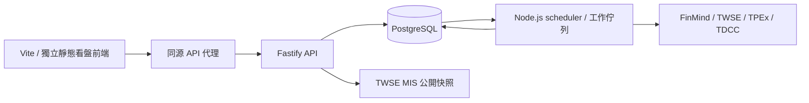

# 股票智能助手架構

更新：2026-10-11，版本1.2.0。後端全部使用 Node.js ES modules，不依賴其他語言程序、套件或分析子程序。前端使用 Vite、Bootstrap 與 ES modules MVC；開發服務及正式靜態網站均獨立於API。Fastify不提供看盤前端。

## 程式責任

| 位置                                                              | 責任                                                     |
| ----------------------------------------------------------------- | -------------------------------------------------------- |
| api/index.js、api.js、contracts.js                                | 啟動、路由、驗證、API文件及文件專用資源                  |
| api/config.js、db.js、migrations                                  | 環境、連線池、交易與可重跑 SQL 遷移                      |
| api/service.js                                                    | 行情驗證、唯一資料、修訂、完成資料分析與查詢             |
| api/providers.js、market.js、trading.js                           | 來源限流重試、公司／集保／ETF、股票目錄、五檔、交易日曆  |
| api/jobs.js、cli.js                                               | 持久工作排隊、心跳、恢復、排程及一次性命令               |
| api/indicators.js、charting.js                                    | 技術指標、先暖機後截取區間、多週期聚合與正式訊號         |
| api/fundamentals.js、financial-metrics.js、financial-catalog.json | 財務期間、科目映射、缺值、歷史趨勢與38細項               |
| api/equity.js、peers.js                                           | 籌碼分布／流量、來源覆蓋、授權揭露、產業候選與同期間比較 |
| api/calculator.js                                                 | decimal.js 費用、稅、損益兩平與跨級距跳檔                |
| api/market-board.js、market-chips.js                              | 大盤行情、期貨日夜盤、上市法人與融資融券、來源日期與快照 |
| api/media.js                                                      | 公司新聞索引、RSS／Atom、公開討論、關聯與去重            |
| api/strategy.js、research.js                                      | 可追溯研究規則、次根成交回放、滾動 ridge 預測            |
| web/src/models、views、controllers                                | 前端狀態、DOM／SVG呈現、互動與請求取消                   |
| web/src/views/orderbook-view.js                                   | 個股與期貨共用五檔、深度色帶、缺值與委託合計             |

## 儲存契約

加權指數與台指期由api/market-board.js提供獨立行情及歷史區間，來源快照存於market_board_snapshots，不與股票股數混用；盤別、契約及暖機設計見 [市場看板](MARKET_BOARD.md)。

股票代號為字串，保留0050等前導零。量一律存股，37股不截斷；來源張／股單位另外保存。原始與還原價分序列，零股及整股交易類型分開。

bars 的唯一鍵為市場、商品、交易類型、週期、價格基準、具時區時間戳，不含來源；同鍵不同來源回報衝突，不自動切換。日線另外保存交易日期，時間戳採台北13:30；分鐘要求整分鐘。顯示使用 Asia/Taipei。

重跑同內容不增加修訂；更動前保存完整舊 snapshot。舊來源時間及已完成降回未完成皆忽略。行情更新及指標重算在同一交易提交，analysis 只對應目前 bar_revision；未完成資料無正式指標。PostgreSQL 交易鎖序列化寫入。

財務／籌碼快照不可變，保留 dataset、source、received_at、digest、revision、data。重跑依正規化內容及來源去重，也可沿用遷移前 digest。歷史可得性依平台接收時間，財報期間不冒充公告時間；現在取得的舊財報不回填為當年已知。公開報價快照另存 quote_snapshots，不能拼成假的 OHLC。

## 排程與來源

API 將按需回補存入 job_runs，202回應提供工作ID。缺分鐘Token會立即記錄失敗原因，不排隊等待其他來源；相同請求沿用工作，日K仍可使用。等待與執行中的工作不受完成工作快取期限限制，等待時間不能當成失敗心跳。互動工作上限為行情6、籌碼3、財務4；priority=0 的自選排程不占互動名額。Node.js scheduler 每秒檢查，依互動行情、互動分析、定時更新的優先順序claim；使用行鎖，執行程序另持有 schema 專屬 advisory lock，確保同一 schema 只有一個來源消費者。心跳每30秒，中斷恢復最多3次嘗試；只有取得排程鎖的工作程序可恢復 running 工作。來源失敗不等於自動恢復重試，FinMind 請求本身另有4次重試。CLI 可以處理工作；有其他消費者時等待既有工作結果。

每六小時排程 WATCHLIST 日線與財務更新。日線首次從 BACKFILL_START 開始，後續重疊最近10個日曆日抓修正，不重新抓全部。使用者歷史區間另有至少420日暖機；週／月長均線可增加至8000日，分鐘14日。日期輸入、顯示區間、來源實際有資料的期間分開。

所有 FinMind 請求共用程序內限流、45秒來源逾時與最多4次重試；429／5xx退避。工作失敗保留原因，不使用推估值填空。公司及集保快取24小時、MIS10秒、交易日曆1小時。公開行情不可保證即時或完整五檔。

## 計算與限制

MA、Wilder RSI／ATR、MACD、KD、布林通道及量比在所選完成觀測上計算。先取暖機、聚合，再截取顯示範圍。週／月 K 必須區間結束且所有已取得成分完成才標正式；完成不保證無缺漏。窗口以有效觀測計數，不補停牌／無成交為零。一般分鐘以09:00、盤中零股以09:10開始聚合；盤後零股14:30的單次撮合另成一根，不套用一般交易時段。自動分鐘擷取仍只接一般整股，零股分鐘需授權匯入，前台尚無零股行情切換。

費用使用 decimal.js，元以下處理可追溯；API金額是字串。財務要求同期間與連續季，缺必要科目保留null；不以相近科目硬替代。預測僅使用完成還原日線，標準化與訓練標籤只使用當時已完成資料，回傳基準誤差與殘差範圍，不提供交易指令。

目前適合個人自選股規模。大量分鐘線仍需分區、增量重算及正式串流來源；公開快照不替代授權盤中行情。助手可後續接入唯讀API，核心平台目前不需要 Token型語言模型。

## 前端工作流程

主菜單為個股看盤、大盤市場、股票計算機，桌機側欄與手機頂部同步切換中央內容。大盤與計算機不顯示個股行情列、研究導覽及個股日期控制。計算機仍可使用頂部搜尋或自選股選取商品。歷史行情位於技術指標下方，預設收合。策略回放有個股分頁；預測目前只有 API，沒有前台頁面或獨立預測排程。

`web/index.html` 是 Vite 入口，`web/src/main.js` 匯入樣式與模組，待模組完成載入後依序執行 DOM 綁定。Model、View、Controller 以明確 import/export 連接；共用可變狀態由物件管理，避免修改唯讀的匯入綁定。

根目錄 `npm run dev` 或在 web 執行同名指令，啟動127.0.0.1:5173；/api、/health、/docs、/openapi.json代理至API_PROXY_TARGET（預設http://127.0.0.1:8000）。這個設定只供開發工具使用，不將.env金鑰放入前端。Vite preview位於4173，僅供本機預覽。

`npm run build` 產出web/dist；圖片由web/public/images複製至dist/images，程式與樣式建置為assets下的內容雜湊檔。正式前端由獨立靜態網站服務提供，透過反向代理連接API；Nginx範例在web/deploy/nginx.conf。Docker只打包後端，Compose只有三個後端服務，不包含Vite或前端檔案。

API根路徑回傳服務名稱、版本及文件／健康路徑的JSON。工作台、前端原始碼及圖片路徑在API回應404；Swagger的/docs及其專用資源仍可使用。版本取自根package.json，與OpenAPI同步。MIT授權適用專案程式碼，第三方行情及財務資料仍依來源使用條款。
