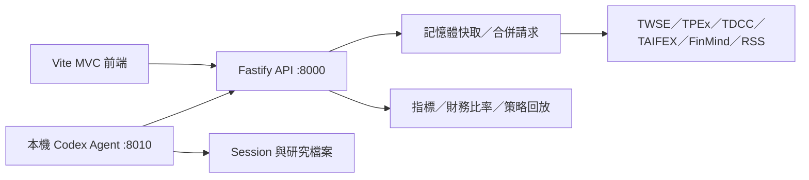

# 架構設計

更新：2026-11-21。套件版本 1.2.0。功能細節見 [功能設計](FEATURES.md)。

## 現行架構

前端 Vite／Bootstrap／JavaScript MVC，股票服務為 Node.js／Fastify。**股票資料完全使用來源 API 與程序內記憶體快取，沒有 SQL 讀寫、資料庫驅動、初始化 SQL、資料遷移或持久排程。** Compose 僅管理 `api`；前端與選用的本機 Codex Agent 分別啟動。



前端所有看盤數字皆經平台 API 取得。技術指標、財務比率與策略回放由 Node.js 使用來源資料計算，並非所有衍生數字都由外部供應商直接提供。記憶體快取會在 API 重啟後清除；不從資料庫或歷史檔案恢復股票資料。

## 八個個股區塊的資料路徑

| 區塊 | 平台資料接口 | 來源與處理 |
| --- | --- | --- |
| 看盤工作台 | `/api/quote`、`/api/stock-data?section=chart` | 公開行情／五檔、來源 K 線、聚合與均線 |
| 技術指標 | 共用 K 線接口、`/api/strategy/analyze` | 完成 K 線、技術指標與事件；歷史行情展開顯示 |
| 基本分析 | `/api/stock-data?section=basic` | 官方公司基本資料；未接入的機構研究明示限制 |
| 財務分析 | `/api/stock-data?section=financial`、`/api/valuation-bands` | FinMind 六份資料及官方每股參考淨值；平台比率與來源倍數參考帶 |
| 籌碼分析 | `/api/stock-data?section=equity` | 法人、融資券、股權、官方申報及有權限的分點資料 |
| 策略回放 | `/api/strategy/backtest` | 來源歷史 K 線及平台策略計算，不保存回測到 DB |
| 同業比較 | `/api/peers`、財務資料接口 | API 股票目錄與已取得財務資料，按需補齊可見頁面 |
| 熱門新聞 | `/api/media` | 近期 RSS 與逐日公司新聞索引分開載入 |

API 返回 `ready`、`updating`、`partial`、`unavailable`。前端切換區塊先顯示畫面與現有資料，來源工作按需啟動；離開區塊停止前端輪詢與下一批補齊。已發送的共享來源請求可能繼續完成，供其他使用者或稍後返回使用。

## 後端模組

| 模組 | 責任 |
| --- | --- |
| `api/api.js`、`contracts.js` | HTTP 接口、參數驗證、OpenAPI 與錯誤處理 |
| `api/bar-validation.js` | 純 K 線格式、時間、價格與股數驗證 |
| `api/direct-data.js` | 股票來源資源、財務／籌碼讀取器及同業組裝 |
| `api/daily-provider.js`、`providers.js` | 區間行情、官方月報備援與 FinMind 連線 |
| `api/source-cache.js` | 有界記憶體快取、同請求合併、失敗冷卻 |
| `api/data-availability.js` | 財務缺項原因、ETF 適用性與來源筆數／日期／範圍標記，不將計算條件不足混為權限問題 |
| `api/fund-data.js` | TWSE ETF 預估／歷史淨值、同類比較、群益 PCF 組合與有限範圍反查 |
| `api/tdcc-history.js` | 集保官方週別與正常表單會話、完整級距及合計驗證、漸進載入、有界快取與重疊請求合併 |
| `api/cathay-funds.js` | 國泰完整目錄、日組合與獨立的季度權重揭露；不推算缺失股數及代號 |
| `api/official-financial.js` | 官方最新季每股參考淨值，不以股本反推股數 |
| `api/valuation-bands.js` | 同日原始收盤價與來源倍數換算，歷史分位不讀未來值；非重算基本面估值 |
| `api/source-queue.js`、`source-budget.js` | 前景優先、來源間隔與滾動一小時預算 |
| `api/source-errors.js` | 固定安全訊息，不洩露原始錯誤文字或憑證 |
| `api/market.js`、`trading.js` | 股票目錄、行情快照與交易日曆 |
| `api/charting.js`、`indicators.js`、`technical-events.js` | K 線聚合、技術計算與事件 |
| `api/fundamentals.js`、`financial-metrics.js` | 純財務整理、比率及歷史計算 |
| `api/equity.js`、`chip-workspace.js`、`ownership-provider.js` | 籌碼計算及官方揭露 |
| `api/peers.js`、`media.js` | 同業比較與新聞資料 |
| `api/strategy.js`、`research.js` | 策略回放與既有研究計算 |
| `api/market-board.js`、`market-chips.js` | 大盤、期貨日夜盤與市場籌碼 |
| `api/direct-research.js`、`research-packet.js` | 既有研究接口相容，僅接受明確來源讀取器 |

財務、籌碼、同業及研究組裝不含 SQL 備援。缺少必要來源讀取器時立即回報設定錯誤，不嘗試連線資料庫。Agent 的工具定義、技能與對話流程留待下一階段調整，本次保留既有接口相容。

## 快取、排隊與效能

- 個股快照約 10 秒快取；股票來源資源最多 96 項，進行中的相同請求合併。K 線依區間通常 5 分鐘或 1 小時，財務／籌碼 30 分鐘。
- FinMind 預設 1 秒間隔、單一 API 程序共用滾動一小時 300 次預算。每次重試也計入；額度用完回報狀態，不無限等待。實際帳戶或 IP 額度仍由來源判定，多程序部署需分配或共享預算。
- 開啟中的財務優先於背景同業及新聞。若開啟正在背景取得的同一檔股票，提升原工作，不重複查詢。失敗退避等待不獨占來源隊列，已發送請求不強制中斷。
- 財務來源未變動時重用計算結果；部分來源失敗一分鐘後可再查，仍有效的成功資料保留原接收時間，不整批重抓。
- 權限拒絕依帳戶與資料集快取 30 分鐘，跨股票共用。更新 Token 並重建 API 後重新核對；Token 存在不代表具備所有會員權限。
- 最新新聞可先顯示，逐日索引繼續補齊。同業完整名單先列出，只自動補可見頁面，仍可手動補齊全部。

畫面切換耗時與來源完成耗時分開測量。冷啟動、長區間、來源逾時與配額仍會影響等待；不保證外部資料永遠秒開。`/health` 的 `source_activity` 提供排隊數、處理中資料集、耗時及本機預算，不包含 Token、查詢 URL 或股票代號。

## 來源與限制

上市短區間原始日線優先 TWSE 月報；超過 93 日使用單次 FinMind 區間查詢，失敗後改用官方月報。上櫃歷史與還原價依來源權限取得。每根 K 線保留實際來源、來源時間、接收時間與原始／還原價格口徑，不把四捨五入張數冒充精確股數。

分鐘 K、主力集中度、券商分點需要相應 FinMind Sponsor 權限。股權分布優先集保官網近一年週資料，依使用者區間及官方週別清單取得。為相容既有指標仍沿用 `TaiwanStockHoldingSharesPer` 資料集鍵，實際來源為 `tdcc_history`，不表示呼叫了 FinMind。每週立即更新記憶體快照與來源進度，失敗保留缺週；官網失敗才使用既有備援，最新週備援不冒充完整歷史。申報轉讓空紀錄不等於權限不足。

全市場基金正式持股與機構目標價尚未接入；群益 PCF 與國泰投信日組合只屬部分來源，逐筆保留口徑。國泰季度權重另列，不混入日組合反查；來源沒有代號或股數時留空。指定主動 ETF 的 FinMind 來源仍需追蹤清單及權限。加權指數沒有個股式五檔；台指期保留契約月份與日／夜盤，不拼接成未驗證連續契約。

基金接口新增 `section=quarterly`，僅以截止核對來源最新季度；期間晚於截止則排除。季度期間不等於公告日期，僅提供目前來源揭露，不支援歷史當時已知版本。MOPS 直接季報查詢本次未回傳可驗證持股表，未將其列入成功來源或以零值補齊。

`GET /api/fund-data/:market/:symbol?section=nav|portfolio|holders|quarterly&start=YYYY-MM-DD&end=YYYY-MM-DD` 按需取得基金資料；NAV 支援區間，PCF 僅提供最新組合，以來源估值日核對截止，不要求截止等於今天。週末可看前一交易日組合；估值日晚於截止時回覆 `outside_range` 並排除明細，不回填歷史。反查逐檔核對日期，保留成功、可納入、區間外及失敗數；零個可納入且來源失敗不標成部分可用或真實零筆。快照共用 15 秒快取、歷史淨值 30 分鐘、PCF 一小時、官方目錄及每股參考淨值 24 小時；每股參考淨值另按台北日期分鍵，避免跨日沿用前一天資源。均為有界記憶體資源及請求合併，沒有持久儲存。反查仍只涵蓋已接入的群益及國泰國內成分 ETF，最多三路並行。

官方每股參考淨值查詢遇到單一產業表失敗，仍會查其他產業表。若成功找到標的，回傳實際來源；若沒有找到而且部分表失敗，回覆來源錯誤，不能宣稱此股沒有資料。

`GET /api/valuation-bands/:market/:symbol?field=PER|PBR&start=YYYY-MM-DD&end=YYYY-MM-DD` 使用完成的原始日 K 與同日正值來源倍數換算。只使用當日及以前最近 252 筆有效樣本，至少 60 筆；不是核對完整股數與公司行動後的標準河流圖，也不提供歷史當時已知版本。

可以回看來源提供的歷史價格及財務序列，但不具備歷史當時可得版本與持久修訂紀錄。嚴格歷史時點研究回覆限制。未完成 K 線不產生正式收盤訊號，缺值不補零，回測與預測不保證績效。

## 啟動、相容與儲存

```sh
npm ci
npm run setup
docker compose up -d --build api
npm run dev
```

API `8000`，Vite `5173`，選用 Agent `8010`。正式前端部署 `web/dist`，代理股票 API 到 `8000`、助手到 `8010`。API 不提供前端靜態頁面。

已刪除初始化 SQL、PostgreSQL 驅動／服務／設定、持久 worker、匯入實作、SQL 測試與遷移腳本。保留舊寫入接口的金鑰驗證與停用回應（`410`），避免改變既有認證邊界；舊工作查詢回空清單，不存在可執行的背景工作。一般看盤不使用 `INGEST_API_KEY`。

對話與研究檔案仍位於 `sessions/`、`reports/`，本次不刪除。既有本機備份與已停止容器的歷史資料卷不作為執行依賴，也不以一般更新流程刪除。

## 驗證

`npm run audit:data` 依序查核上市、上櫃與 ETF 樣本，逐區塊保留實際來源狀態、財務缺項與籌碼權限；單一接口失敗仍繼續查其他區塊。結果寫入 `.tmp/data-audit-latest.json`，僅供診斷，不讀回作為股票來源或持久快取。可傳 `--stocks TWSE:2409,TPEX:6147,TWSE:00927 --start 2026-09-21 --end 2026-11-20`。新聞另限最近 31 日，索引抽查截止單日，不宣稱已查完整新聞歷史。

`npm test` 驗證來源格式、權限、無 DB 依賴、認證邊界、計算、技術事件及既有 Session 相容。`npm run verify` 檢查真實 API 資料與策略回放；`npm run verify:browser` 驗證八區塊切換、有效財務數值、集保資料、新聞先顯示、策略回放及桌機／手機排版。外部來源失敗與程式測試失敗分別報告。

2026-11-20 最新驗證：72 項測試、前端建置、八區塊 API、來源覆蓋查核及瀏覽器驗證通過，包含真正執行策略回放、ETF 四項淨值快照與歷史圖、30 檔 PCF 股票組合、同類基金比較、官方每股參考淨值及來源倍數參考帶。2409 取得 85 個有值財務指標、17 級集保資料；畫面切換與來源完成時間分開評估，非來源延遲保證。全專案 `format:check` 尚有未修改的 `agent/AGENTS.md` 格式問題。本次未執行 Codex 模型分析。

2026-11-21 免費來源驗證：83 項測試、建置、八區塊 API 與瀏覽器驗證通過；新增集保多週圖表、52／52 週實測、國泰日組合與季度權重表。來源都為即時查詢與記憶體快取，未增加股票 DB、付費服務或持久排程。
