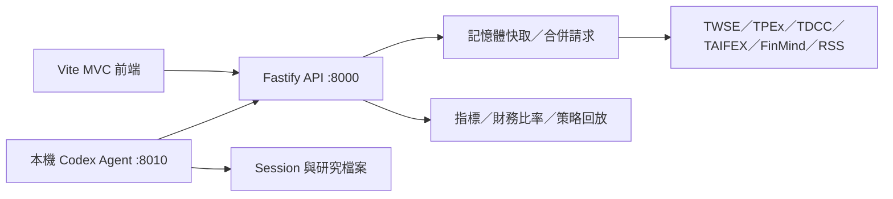

# 架構設計

更新：2026-11-20。套件版本 1.2.0。功能細節見 [功能設計](FEATURES.md)。

## 現行架構

前端 Vite／Bootstrap／JavaScript MVC，股票服務為 Node.js／Fastify。**股票資料完全使用來源 API 與程序內記憶體快取，沒有 SQL 讀寫、資料庫驅動、初始化 SQL、資料遷移或持久排程。** Compose 僅管理 `api`；前端與選用的本機 Codex Agent 分別啟動。



前端所有看盤數字皆經平台 API 取得。技術指標、財務比率與策略回放由 Node.js 使用來源資料計算，並非所有衍生數字都由外部供應商直接提供。記憶體快取會在 API 重啟後清除；不從資料庫或歷史檔案恢復股票資料。

## 八個個股區塊的資料路徑

| 區塊 | 平台資料接口 | 來源與處理 |
| --- | --- | --- |
| 看盤工作台 | `/api/quote`、`/api/stock-data?section=chart` | 公開行情／五檔、來源 K 線、聚合與均線 |
| 技術指標 | 共用 K 線接口、`/api/strategy/analyze` | 完成 K 線、技術指標與事件；歷史行情展開顯示 |
| 基本分析 | `/api/stock-data?section=basic` | 官方公司基本資料；未接入的機構研究明示限制 |
| 財務分析 | `/api/stock-data?section=financial` | FinMind 六個資料集、平台比率／歷史比較與計算結果快取 |
| 籌碼分析 | `/api/stock-data?section=equity` | 法人、融資券、股權、官方申報及有權限的分點資料 |
| 策略回放 | `/api/strategy/backtest` | 來源歷史 K 線及平台策略計算，不保存回測到 DB |
| 同業比較 | `/api/peers`、財務資料接口 | API 股票目錄與已取得財務資料，按需補齊可見頁面 |
| 熱門新聞 | `/api/media` | 近期 RSS 與逐日公司新聞索引分開載入 |

API 返回 `ready`、`updating`、`partial`、`unavailable`。前端切換區塊先顯示畫面與現有資料，來源工作按需啟動；離開區塊停止前端輪詢與下一批補齊。已發送的共享來源請求可能繼續完成，供其他使用者或稍後返回使用。

## 後端模組

| 模組 | 責任 |
| --- | --- |
| `api/api.js`、`contracts.js` | HTTP 接口、參數驗證、OpenAPI 與錯誤處理 |
| `api/bar-validation.js` | 純 K 線格式、時間、價格與股數驗證 |
| `api/direct-data.js` | 股票來源資源、財務／籌碼讀取器及同業組裝 |
| `api/daily-provider.js`、`providers.js` | 區間行情、官方月報備援與 FinMind 連線 |
| `api/source-cache.js` | 有界記憶體快取、同請求合併、失敗冷卻 |
| `api/source-queue.js`、`source-budget.js` | 前景優先、來源間隔與滾動一小時預算 |
| `api/source-errors.js` | 固定安全訊息，不洩露原始錯誤文字或憑證 |
| `api/market.js`、`trading.js` | 股票目錄、行情快照與交易日曆 |
| `api/charting.js`、`indicators.js`、`technical-events.js` | K 線聚合、技術計算與事件 |
| `api/fundamentals.js`、`financial-metrics.js` | 純財務整理、比率及歷史計算 |
| `api/equity.js`、`chip-workspace.js`、`ownership-provider.js` | 籌碼計算及官方揭露 |
| `api/peers.js`、`media.js` | 同業比較與新聞資料 |
| `api/strategy.js`、`research.js` | 策略回放與既有研究計算 |
| `api/market-board.js`、`market-chips.js` | 大盤、期貨日夜盤與市場籌碼 |
| `api/direct-research.js`、`research-packet.js` | 既有研究接口相容，僅接受明確來源讀取器 |

財務、籌碼、同業及研究組裝不含 SQL 備援。缺少必要來源讀取器時立即回報設定錯誤，不嘗試連線資料庫。Agent 的工具定義、技能與對話流程留待下一階段調整，本次保留既有接口相容。

## 快取、排隊與效能

- 個股快照約 10 秒快取；股票來源資源最多 96 項，進行中的相同請求合併。K 線依區間通常 5 分鐘或 1 小時，財務／籌碼 30 分鐘。
- FinMind 預設 1 秒間隔、單一 API 程序共用滾動一小時 300 次預算。每次重試也計入；額度用完回報狀態，不無限等待。實際帳戶或 IP 額度仍由來源判定，多程序部署需分配或共享預算。
- 開啟中的財務優先於背景同業及新聞。若開啟正在背景取得的同一檔股票，提升原工作，不重複查詢。失敗退避等待不獨占來源隊列，已發送請求不強制中斷。
- 財務來源未變動時重用計算結果；部分來源失敗一分鐘後可再查，仍有效的成功資料保留原接收時間，不整批重抓。
- 權限拒絕依帳戶與資料集快取 30 分鐘，跨股票共用。更新 Token 並重建 API 後重新核對；Token 存在不代表具備所有會員權限。
- 最新新聞可先顯示，逐日索引繼續補齊。同業完整名單先列出，只自動補可見頁面，仍可手動補齊全部。

畫面切換耗時與來源完成耗時分開測量。冷啟動、長區間、來源逾時與配額仍會影響等待；不保證外部資料永遠秒開。`/health` 的 `source_activity` 提供排隊數、處理中資料集、耗時及本機預算，不包含 Token、查詢 URL 或股票代號。

## 來源與限制

上市短區間原始日線優先 TWSE 月報；超過 93 日使用單次 FinMind 區間查詢，失敗後改用官方月報。上櫃歷史與還原價依來源權限取得。每根 K 線保留實際來源、來源時間、接收時間與原始／還原價格口徑，不把四捨五入張數冒充精確股數。

分鐘 K、主力集中度、券商分點需要相應 FinMind Sponsor 權限。股權歷史不足時可使用 TDCC 最新免費週資料，並清楚標示只含最新週、不回填成完整歷史。申報轉讓使用公開來源，空紀錄不等於權限不足，也不能推論歷史從未申報。

一般基金持股、機構目標價尚未接入。指定主動 ETF 需追蹤清單及權限。加權指數沒有個股式五檔；台指期保留契約月份與日／夜盤，不拼接成未驗證連續契約。

可以回看來源提供的歷史價格及財務序列，但不具備歷史當時可得版本與持久修訂紀錄。嚴格歷史時點研究回覆限制。未完成 K 線不產生正式收盤訊號，缺值不補零，回測與預測不保證績效。

## 啟動、相容與儲存

```sh
npm ci
npm run setup
docker compose up -d --build api
npm run dev
```

API `8000`，Vite `5173`，選用 Agent `8010`。正式前端部署 `web/dist`，代理股票 API 到 `8000`、助手到 `8010`。API 不提供前端靜態頁面。

已刪除初始化 SQL、PostgreSQL 驅動／服務／設定、持久 worker、匯入實作、SQL 測試與遷移腳本。保留舊寫入接口的金鑰驗證與停用回應（`410`），避免改變既有認證邊界；舊工作查詢回空清單，不存在可執行的背景工作。一般看盤不使用 `INGEST_API_KEY`。

對話與研究檔案仍位於 `sessions/`、`reports/`，本次不刪除。既有本機備份與已停止容器的歷史資料卷不作為執行依賴，也不以一般更新流程刪除。

## 驗證

`npm test` 驗證來源格式、權限、無 DB 依賴、認證邊界、計算、技術事件及既有 Session 相容。`npm run verify` 檢查真實 API 資料與策略回放；`npm run verify:browser` 驗證八區塊切換、有效財務數值、集保資料、新聞先顯示、策略回放及桌機／手機排版。外部來源失敗與程式測試失敗分別報告。

2026-11-20 清理後驗證：58 項現行測試、前端建置、八區塊 API 驗證及瀏覽器驗證通過，包含真正執行策略回放。2409 取得 83 個有值財務指標、17 級集保資料；八區塊首屏切換單次量測約 29～34 毫秒。冷載入財務約 5.85 秒、籌碼約 4.22 秒；數字僅代表本次樣本，並非來源延遲保證。既有研究接口另測 HTTP 200、`database_used=false`，本次未執行 Codex 模型分析。
