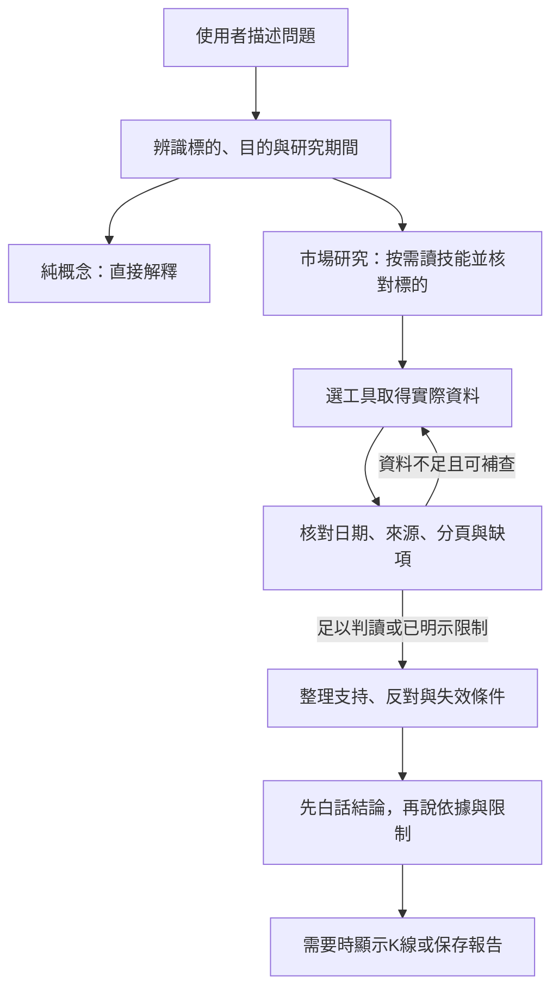

# 功能設計與資料覆蓋

更新：2026-11-24 · 版本：1.2.0

本文件依目前實作整理功能、來源及缺漏，不作為異動日誌。「已接入」不代表每檔股票、每個日期與欄位均有資料；缺資料也不全是權限問題。部署、模組與快取設計見[架構設計](DESIGN.md)。

## 個股看盤總覽

| 區塊                      | 目前提供                                       | 主要缺漏                                 |
| ------------------------- | ---------------------------------------------- | ---------------------------------------- |
| [看盤工作台](#看盤工作台) | 報價、五檔、歷史走勢、K 線與區間切換           | 分 K 權限、獨立零股行情、完整逐筆串流    |
| [技術指標](#技術指標)     | 均線、動能、波動指標、逐根技術事件、歷史行情   | 暖機資料不足不計算；未涵蓋所有 K 棒型態  |
| [基本分析](#基本分析)     | 公司基本資料、上市 ETF 基金資料                | 法人目標價、上櫃 ETF 完整分類            |
| [財務分析](#財務分析)     | 五大分類、歷史圖表／表格、ETF 淨值與組合       | 細科目、歷年淨值、股數調整與部分計算條件 |
| [籌碼分析](#籌碼分析)     | 九子頁、法人、融資券、集保、董監、部分基金組合 | 主力／分點權限、全市場基金持股及部分歷史 |
| [策略回放](#策略回放)     | 固定策略模擬、交易紀錄與績效                   | 實際成交條件、完整公司行動與進階預測介面 |
| [同業比較](#同業比較)     | 同業清單、同期間比較、中位數、ETF 同類比較     | 部分同期間數字、ETF 總報酬及追蹤誤差     |
| [熱門新聞](#熱門新聞)     | 區間新聞索引、近期新聞與公開討論連結           | 完整歷史、全站論壇及輿情評分             |

### 個股看盤資料入口

下表為平台接口分類，個股路徑省略 `/:market/:symbol`。各區塊的功能、來源限制與計算口徑見後續章節；後端分層與請求流程見[架構設計](DESIGN.md#請求與資料流)。

| 區塊       | 平台資料接口                                                | 來源與處理                                                   |
| ---------- | ----------------------------------------------------------- | ------------------------------------------------------------ |
| 看盤工作台 | `/api/quote`、`/api/stock-data?section=chart`               | 公開行情／五檔、來源 K 線、聚合與均線                        |
| 技術指標   | 共用 K 線接口、`/api/strategy/analyze`                      | 完成 K 線、技術指標與事件；歷史行情展開顯示                  |
| 基本分析   | `/api/stock-data?section=basic`                             | 官方公司基本資料；未接入的機構研究明示限制                   |
| 財務分析   | `/api/stock-data?section=financial`、`/api/valuation-bands` | FinMind 六份資料及官方每股參考淨值；平台比率與來源倍數參考帶 |
| 籌碼分析   | `/api/stock-data?section=equity`                            | 法人、融資券、股權、官方申報及有權限的分點資料               |
| 策略回放   | `/api/strategy/backtest`                                    | 來源歷史 K 線及平台策略計算，不保存回測到 DB                 |
| 同業比較   | `/api/peers`、財務資料接口                                  | API 股票目錄與已取得財務資料，按需補齊可見頁面               |
| 熱門新聞   | `/api/media`                                                | 近期 RSS 與逐日公司新聞索引分開載入                          |

## 共通資料規則

- **來源**：八個區塊由後端直接查來源 API／公開接口，搭配程序內記憶體快取，不讀寫股票資料 DB。選定股票不會啟動寫入股票 DB 的排程。
- **載入**：依區塊按需取得；重資料分批載入。快取命中可立即顯示；失效後仍受上游速度、節流及額度影響，不保證所有區塊立即完成。
- **識別與單位**：代號為字串，保留前導零；數量以股為基準，可換算張，比例不換算。只有金額或權重時不反推股數。
- **價格與時間**：原始／還原價格分開，分鐘線帶時區、日線存交易日期，畫面採 `Asia/Taipei`。行情時間、資料日與接收時間分開。
- **完整性**：正式收盤事件只使用完成 K 線；缺值不補零，來源失敗不當成沒有資料，最新一期不回填歷史。
- **歷史界線**：現在取得的歷史序列不等於歷史當時已公布資料。財務／籌碼未重建當時可得版本時明示限制；來源模式沒有 DB 快照與修訂紀錄。
- **顏色**：紅為上漲／淨買超或條件改善，綠為下跌／淨賣超或衰退，黃為提醒，藍灰為背景／缺資料。費用、負債與現金流不能只依正負判好壞。

### 來源更新與快取

以下為常用預設，依資源、日期與錯誤狀態調整；有效期限不代表每個來源都已公布新資料。各項都只存 API 程序記憶體，不是 DB 收集排程。

| 資源／控制         | 預設行為                                                                                                       |
| ------------------ | -------------------------------------------------------------------------------------------------------------- |
| 個股公開報價       | 約 10 秒快取；保留行情與接收時間                                                                               |
| 股票來源資源       | 最多 96 項，同請求合併；日 K 通常 5 分鐘或 1 小時，財務／籌碼 30 分鐘                                          |
| 基金與官方參考     | 基金最新快照 15 秒、歷史淨值 30 分鐘、公開日組合 1 小時、官方目錄與最新季每股參考淨值 24 小時；依來源實作分鍵  |
| FinMind 節流與額度 | 預設每秒一個請求、單一程序滾動一小時 300 次，重試也計入；可透過設定調整，實際來源額度仍由帳號／IP 決定         |
| 部分失敗           | 成功資料保留接收時間；可重試來源依冷卻規則再查，部分錯誤一分鐘後可重新取得；權限拒絕依帳戶及資料集快取 30 分鐘 |

前景財務優先於背景同業與新聞；同業先列名單再按需補可見頁面，新聞近期內容與逐日索引分開載入。區塊切換速度不等於所有來源完成速度，不能因快取立即回傳就推論正在讀舊 DB。

### 缺資料的判讀

| 狀態               | 意義與處理                                             |
| ------------------ | ------------------------------------------------------ |
| 載入中／部分完成   | 仍在查詢或部分期間成功，呈現進度及失敗部分             |
| 權限不足           | 來源要求目前帳號沒有的方案，不以免費代理值冒充         |
| 金鑰無效／額度不足 | 驗證或請求限制，與權限不足、真正空資料分開             |
| 未設定             | 缺必要設定，例如追蹤基金名單                           |
| 尚未串接           | 尚無可驗證且已接入的來源，不宣稱升級方案即可解決       |
| 區間外             | 資料日不符查詢範圍，不以最新一期補歷史                 |
| 來源空資料         | 查詢成功但指定股票／期間沒有資料，不推論其他期間也沒有 |
| 來源失敗           | 逾時、異常、格式變更或部分失敗，保留錯誤與重試狀態     |
| 計算條件不足       | 缺科目、連續季度或股數調整，列出依賴並保留相關原始值   |
| 不適用             | ETF 等不適用公司財報，不反覆查詢或解讀成公司衰退       |

## 看盤工作台

**已提供**：代號／名稱搜尋、自選股、報價、漲跌、成交量、五檔、即時與歷史區間。圖表提供 K 線／走勢、查值、拖曳、縮放、重設、均線及週期選擇，標示來源時間與未完成 K 線。

**來源與更新**：即時報價／五檔使用 MIS 公開行情。上市原始日線優先使用證交所月行情，長區間搭配 FinMind；上櫃、較早期間與還原行情依來源支援使用 FinMind。依實際交易資料過濾區間，不建立假日 K 線。

| 缺漏           | 原因／界線                                                              |
| -------------- | ----------------------------------------------------------------------- |
| 分 K、時 K     | 需要可用分鐘來源，目前 FinMind 權限可能阻擋；有週期選單不代表已取得資料 |
| 完整即時串流   | 公開快照不是授權逐筆成交，無法保證完整深度與毫秒更新                    |
| 獨立零股行情   | 股數可表示零股，但尚無獨立盤中零股報價／五檔切換                        |
| 長期與還原行情 | 依來源覆蓋／權限，不用快照補造歷史 K 線                                 |

## 技術指標

**已提供**：均線、RSI、MACD、KD、布林通道、ATR、量比與對應圖表。歷史行情收合於指標卡片下方。

**來源與更新**：與工作台共用來源 K 線；先取得前置資料計算，再裁切顯示區間。正式事件只用完成 K 線，保留日期、指標值與判斷依據。

| 圖上技術事件 | 內容                                       |
| ------------ | ------------------------------------------ |
| 均線交叉     | MA5／MA20 黃金交叉、死亡交叉               |
| 趨勢排列     | MA5、MA20、MA60 進入多頭／空頭排列         |
| 動能交叉     | MACD、KD 交叉                              |
| 均線突破     | 收盤站上／跌破 MA20                        |
| 區間突破     | 突破先前 20 根高點／跌破低點，基準排除當根 |

**缺漏與限制**：暖機不足留空，分鐘來源不可用時相關指標也不可用。尚未涵蓋所有 K 棒型態，也未證明每種訊號的勝率；技術事件不是單獨的買賣指令。

## 基本分析

**已提供**：公司名稱、代號、市場、產業與來源提供的基本資料；上市 ETF 另列基金類型、追蹤指數、投信、保管機構及發行資訊。

**來源與更新**：使用 TWSE／TPEx 公開公司資料及證交所 ETF 基本資料。此區只查基本資料，不等待全部財務／籌碼；股利及估值放財務分析，不重複放基本面快覽。

**缺漏與限制**：法人目標價尚未接入可驗證授權來源，不能用技術價位替代。上櫃 ETF 完整基金分類尚未接入；基本資料不等於完整企業業務研究。

## 財務分析

### 功能分類

一般股票共 38 個細項：33 個數值／報表或來源參考帶細項、1 個官方文件入口、4 個仍缺必要計算條件的細項。這是功能分類，不代表每檔 33 頁都有完整數字。ETF 另加淨值、組合與季度揭露三頁。

| 分類       | 細項範圍                                                                                 |
| ---------- | ---------------------------------------------------------------------------------------- |
| 財務報表   | 每月營收、EPS、每股淨值、損益表、資產、負債與權益、現金流、股利、電子書                  |
| 獲利能力   | 利潤比率、費用率拆解、業外占比、ROE／ROA、杜邦、週轉率／天數、合約負債占營收、股利發放率 |
| 安全性分析 | 財務結構、流速動比率、利息保障、現金流量、營業現金對淨利、盈餘再投資比率                 |
| 成長性分析 | 月營收、營收、毛利、營業利益、稅後淨利、EPS、合約負債成長                                |
| 價值評估   | PER／PBR 評價與參考帶、股息殖利率及平均股息相關頁；ETF 淨值、組合、季度揭露              |

桌面以分類／細項導覽，手機使用下拉選單；內容依序為摘要、多指標圖、同期間表格與原始證據。金額、百分比、倍數分圖，可選期間、指標、金額單位與表格期數。選單依參考清單對齊，**不宣稱與財報狗全部公式、控制項及覆蓋一致**。

### 來源與更新

| 資料                         | 已接來源與範圍                                                     |
| ---------------------------- | ------------------------------------------------------------------ |
| 公司財務、月營收、股利、估值 | FinMind 六類資料集，財務請求約五年，實際覆蓋依來源                 |
| 每股淨值                     | TWSE／TPEx 官方最新季每股參考淨值，依產業報表取值                  |
| ETF 淨值／折溢價             | MIS 盤中估計與前日淨值、證交所 e 添富歷史分開標示                  |
| ETF 日組合                   | 群益、國泰公開組合，保留估值日、揭露基準、適用日（來源有提供才填） |
| ETF 季度揭露                 | 國泰季度投資標的及權重，與日組合分開                               |
| 估值參考帶                   | 同日原始收盤價與來源 PER／PBR，搭配過去有效倍數分位數換算          |

### 缺漏與原因

| 缺項                       | 原因／處理                                                          |
| -------------------------- | ------------------------------------------------------------------- |
| 費用、應收／應付等細科目   | 來源未必拆銷售、管理、研發、票據等，留空，不分攤或推定為零          |
| 歷年每股淨值               | 官方補強只有最新季，不回填歷史、不以股本猜股數                      |
| 現金股利發放率             | 缺同一盈餘年度完整股利及同股數基準年度 EPS                          |
| EPS 成長率                 | 缺追溯調整 EPS、配股／分割依據，先保留來源 EPS                      |
| 平均現金股息殖利率／河流圖 | 缺完整年度股利、平均窗口、股數調整及逐時點可得依據                  |
| 標準 PER／PBR 河流圖       | 現有是來源倍數換算參考帶，並非已驗證歷史 EPS／BVPS 的標準河流圖     |
| 財報電子書                 | 有官方入口，尚無完整可驗證 PDF 清單及解析                           |
| ETF 覆蓋                   | 上櫃 ETF 淨值歷史、其他投信季度來源未完整接入；部分來源只有最新組合 |
| MOPS 基金季報直接資料      | 入口已查證，但直接查詢未取得可驗證持股明細，不列為成功接入          |
| 參考網站細部控制           | 合併／個別營收、完整年度切換、年度 ROA 等尚未全面對齊               |

### 計算與解讀界線

- ROE 採同季淨利與相鄰季平均權益；主頁 ROA 加回同季稅後利息，有效稅率不成立則留空。杜邦不混搭不同季度。
- 週轉率採單季流量／平均存量，未年化；天數採 90 日／週轉率。必要票據、應收、預付款缺漏不假設零。
- 現金流累計轉單季須核對前季與相同年初餘額，不以半年現金流除單季淨利。自由現金流僅扣已辨識設備支出，明示涵蓋限制。
- 盈餘再投資比率採四年投資存量增加／近 16 季淨利，需連續季度及四年前同季資產，合計淨利非正不計百分比。
- 股利區分盈餘年度、公告／除息／發放日；單筆不是全年。未確認股數基準的 EPS 不直接加總成年／近四季 EPS。
- 成長率基期為零／負數不套一般百分比；近四季年增需連續八季。費用下降、負債增加或合約負債成長不能直接判好壞。
- 估值帶截至該日最多取 252 筆有效來源倍數的 20／40／60／80 分位數，至少 60 筆，不使用未來倍數，也不宣稱為合理買賣價。

狀態區分可用、部分、無資料、依賴不足與參考入口；有相關資料不會解除主計算缺項。完整細項及公式見 [financial-catalog.json](../api/financial-catalog.json) 與 [financial-metrics.js](../api/financial-metrics.js)。

## 籌碼分析

### 九個子頁的覆蓋

| 子頁          | 已接資料                             | 缺漏／限制                                      |
| ------------- | ------------------------------------ | ----------------------------------------------- |
| 法人買賣      | FinMind 三大法人買賣超、外資持股存量 | 區間流量與期末存量分開，不是同一指標            |
| 主力進出      | 主力代理／集中度查詢與狀態呈現       | 目前 FinMind 方案不足；代理值不是已識別主力身分 |
| 券商分點      | 分點明細查詢與狀態呈現               | 目前來源權限不足，不補造排名                    |
| 大戶散戶      | 集保週頻級距彙整                     | 持股門檻不等於實際自然人／法人身分              |
| 籌碼分布      | 集保官方近一年歷史級距、最新週備援   | 僅取當次官方清單週別，不提供無限歷史            |
| 融資融券      | FinMind 融資、融券及變化             | 依交易日及來源欄位覆蓋                          |
| 董監持股      | 官方最新月持股                       | 非完整歷年；資料月份不等於公告日                |
| 申報轉讓      | 官方最新可取得申報檔                 | 非完整歷史，最新無資料不代表歷來無申報          |
| ETF／基金持股 | 群益、國泰公開日組合與部分個股反查   | 非全市場，國泰季度揭露另列，不混入日組合        |

### 來源、更新與區間

- 集保先使用免費官方歷史，逐週取得並顯示進度；核對代號、日期、級距及合計。歷史失敗才使用可用的 FinMind／最新週備援，保留實際來源。
- 同股同週請求合併、全程序節流；連續三週失敗停止本輪，區分成功、失敗及未查詢，不將部分資料標成完整。
- 通常有 15 個主要級距及合計，差異數調整另列；不能假設每週固定 17 筆，缺人數不補零。
- 張／股可切換，1 張＝1,000 股，比率不換算。外資持股比例、淨買超、級距占比與基金組合權重各保留原定義。
- 日組合依估值日核對截止；週末可看前一交易日。來源只有最新組合時不回填早期截止日，也不提供無作用的起始日期。
- 個股基金反查只涵蓋已接、可確認國內成分的基金；不同揭露日不冒充同日，不以今日價格推算過去持股金額。
- FinMind 主動式 ETF 路徑仍受方案及 `ETF_WATCHLIST` 設定限制，與免費投信來源分開判讀。

## 策略回放

**已提供**：固定策略歷史模擬、交易紀錄與績效。完成 K 線產生條件後，以下一根開盤模擬；含 ATR 停損、2R 目標、費用與滑價假設，同根同時碰停損／目標時採停損優先。

**來源與更新**：使用平台來源 K 線與技術計算，不讀股票 DB；依股票、期間與參數計算，暖機資料和評估區間分開。

**缺漏與限制**：未完整模擬排隊、漲跌停、流動性、公司行動及實際券商逐筆費用，費率假設不等於計算機完整規則。財務／籌碼未重建當時可得版本時，不能宣稱為無前視偏誤的多因子回測。另有 Ridge 五日預測研究 API，尚未形成完整前台流程；殘差分位數不是經校準信賴區間，沒有保證勝率或自動交易。

## 同業比較

**已提供**：產業候選與已維護業務群組，包含友達／群創、景碩／欣興／南電。公司比較 PER、PBR、殖利率、營收年增、EPS、毛利率、營益率、負債比；ETF 優先依官方類型／指數列同類，不套公司 EPS。

**來源與更新**：先顯示候選，分頁查可見同業資料，離開區塊停止啟動後續批次；全部載入仍受額度限制。同業中位數需同期間、至少兩家有效同業且排除本身；ETF 保留共同參考日與實際資料日。

**缺漏與限制**：產業分類不代表營收結構完全相同。缺同季資料時不強行混季，尚未載入不等於 API 無資料。上櫃 ETF 分類、含息總報酬、完整費用及追蹤誤差比較尚未完整接入。

## 熱門新聞

**已提供**：公司新聞單日／區間索引，標題、來源、時間與原文連結；近期 Yahoo 新聞與 PTT 等公開討論索引分開呈現，以名稱或完整代號核對關聯。

**來源與更新**：FinMind 索引逐日分批，單次最多 31 個日曆日，保留失敗日期及進度；包含假日。近期 RSS 與歷史索引分開載入，索引不阻擋近期內容先顯示。Google RSS 預設停用，保留搜尋入口。

**缺漏與限制**：來源不保證完整收錄，近期 RSS 不能代替歷史檔案。論壇只有可取得的索引／連結，沒有全站歷史、完整討論串、會員內容或新聞全文。「熱門」目前不是驗證過的熱度排名，也無完整輿情分數；存取與引用受來源條件限制。

## 股票助手

**使用方式**：啟動本機 Agent，在股票助手新增 Session 後直接描述問題，不必先選股票。可換股、跨股比較或詢問大盤；每段對話保留自己的 Codex thread、串流內容、查詢證據及產物。使用訂閱登入，不需要模型 API Key。

### 能分析什麼

助手可研究個股／ETF 的走勢、財務、籌碼、相對估值、同業差異、新聞與大盤背景，也可依明示持倉試算毛損益、呼叫固定策略回放，按需產生 K 線引導與 Markdown 報告。純名詞解釋可直接回答；涉及目前市場事實時，先查平台資料。

| 回覆中的內容 | 如何產生                                             | 如何閱讀                                         |
| ------------ | ---------------------------------------------------- | ------------------------------------------------ |
| 來源事實     | 工具取得行情、財報、籌碼與新聞等資料                 | 看標的、實際資料日、來源、缺漏與查詢範圍         |
| 計算結果     | 平台指標、估值帶、回放或試算程式計算                 | 看公式／規則、價格基準、單位及費用假設           |
| AI 分析      | Codex 依已查資料及研究技能，整理支持、反對與失效條件 | 屬條件式判讀，不是已驗證勝率、保證獲利或交易指令 |

**目前沒有**全市場任意技術／財務條件掃描、法人目標價來源、完整全市場基金持股、任意策略程式回測或自動下單。研究預測 API 也尚未註冊為 Chat 工具，不能宣稱助手已具備完整股價預測模型。

### 完整工具清單

目前 Chat 註冊 **17 個工具**，依用途分成四組。下列參數由助手填寫，使用者直接以自然語言提問即可。工具存在不等於上游資料永遠可用；最新權限及缺項仍以每次回傳為準。

**一、服務、標的與技能（5 個）**

| 工具                       | 用途／主要輸入                                         | 回傳與限制                                                           |
| -------------------------- | ------------------------------------------------------ | -------------------------------------------------------------------- |
| `get_stock_service_status` | 檢查股票 API，不需選股                                 | API 就緒狀態、連線錯誤與處理提示；不是行情證據，也不代表所有上游正常 |
| `search_stocks`            | 用 `query` 搜尋名稱、簡稱或代號                        | 候選名稱、`market`、字串 `symbol`；有歧義需確認，不是全市場條件選股  |
| `screen_market_stocks`     | 選市場、商品、價格／成交股數／成交額／漲跌幅條件及排序 | 官方盤後候選、交易日期與來源完整性；非盤中排行，未內建技術／財務條件 |
| `list_research_skills`     | 列出可用研究技能                                       | 六種技能的名稱、說明與版本；不查行情                                 |
| `read_research_skill`      | 用 `name` 讀取指定技能                                 | 實際研究方法；查市場資料前先讀查證技能，其他按需讀取，不執行任意腳本 |

**二、行情與研究資料（8 個）**

| 工具                    | 用途／主要輸入                                               | 回傳與限制                                                                                             |
| ----------------------- | ------------------------------------------------------------ | ------------------------------------------------------------------------------------------------------ |
| `get_stock_quote`       | 指定個股／ETF                                                | 公開報價、五檔與時間；快照不是完整逐筆，歷史模式不提供當時五檔                                         |
| `get_stock_data`        | 用 `section` 選面向，可指定區間與分頁                        | 基本資料、技術、財務／籌碼目錄、同業、新聞或大盤；各分區意義見下表，不是一次載入全部                   |
| `get_financial_history` | 不傳 `metric/page` 查目錄；`metric` 查單項，或 `page` 查整頁 | 指標、歷史、多指標細項、報表／股利證據及缺項；`metric/page` 擇一，使用回傳 ID，不猜科目                |
| `get_chip_detail`       | 不傳 `dataset` 查目錄，再指定子頁                            | 法人、分點、集保、融資券、董監等明細及 `dataset_status`；支援目錄 ID、中文名或對應來源名，無權限不代填 |
| `get_fund_data`         | `section=nav/portfolio/quarterly/holders`                    | 依序為淨值與折溢價、日組合、季報、個股被已接基金持有；非全市場，不將不同揭露日混成同日                 |
| `get_valuation_bands`   | 公司標的、`field=PER/PBR`、日期區間                          | 來源倍數換算參考帶及覆蓋；非完整基本面河流圖或合理買賣價，不適用 ETF                                   |
| `get_market_data`       | 不需選個股                                                   | 最新加權指數、台指期與市場法人／融資券；各盤別日期分開，局部失敗保留另一面向                           |
| `get_market_chart`      | `product=index/day/night`、`mode=intraday/history`           | 指數或台指期走勢；期貨盤中需實際 `symbol`，歷史需 `contract=YYYYMM` 與起訖，不拼接連續契約             |

`get_stock_data` 的 `section` 選項：

| 選項                | 實際提供的內容                                                                                        |
| ------------------- | ----------------------------------------------------------------------------------------------------- |
| `overview`／`basic` | 基本資料與來源狀態；`overview` 不是七面向綜合健診                                                     |
| `technical`         | 完成日 K、均線／指標、技術狀態與逐根事件，沿用看盤 API 計算                                           |
| `financial`         | 財務指標目錄、最新值、細項目錄及 coverage；深入查詢使用財務歷史工具                                   |
| `chips`             | 籌碼子頁目錄、摘要指標、定義與 coverage；明細使用籌碼工具                                             |
| `peers`             | 同業候選、目前已載入的比較數字與同期間中位數；可用 `symbols` 指定比較名單，缺數字需先載入相關同業財務 |
| `news`              | 日期區間新聞／討論；`source=recent/index/all`，以 `cursor` 接續 `next_cursor`，未讀完不能稱完整區間   |
| `market`            | 個股研究時附帶大盤報價；完整大盤工具不需選個股                                                        |

**三、試算與策略驗證（2 個）**

| 工具                     | 用途／主要輸入                                                                        | 回傳與限制                                                                                                                                      |
| ------------------------ | ------------------------------------------------------------------------------------- | ----------------------------------------------------------------------------------------------------------------------------------------------- |
| `calculate_trade_profit` | `buy_price`、`sell_price`、使用者明示 `shares`；成本可用 `buy_price_source=user_cost` | 每股價差與毛損益；市場價需本輪來源或合法跳檔依據，不接受任意無來源目標價。此工具不接受費率、不算淨利；多股成本須以 `position_text` 核對原文歸屬 |
| `run_strategy_backtest`  | 標的、起訖及 `fee_bps/slippage_bps/sell_tax_bps`                                      | 既定策略的交易紀錄、績效與回撤；不是任意策略引擎。費率／滑價為研究假設，1 bps＝0.01%                                                            |

**四、圖表與報告（2 個）**

| 工具                   | 用途／主要輸入                          | 回傳與限制                                                                                            |
| ---------------------- | --------------------------------------- | ----------------------------------------------------------------------------------------------------- |
| `show_stock_chart`     | 標的、可選 `start/end/focus_date`       | 在對話顯示真實完成日 K 與事件；可聚焦交易日，單張最多顯示一頁 120 根，不畫分鐘圖或捏造未來 K 線       |
| `save_research_report` | `title`、Markdown 與本輪 `evidence_ids` | 顯示並隨 Session 保存報告；只接受已取得的有效引用並檢核金額／價位，不是每則對話必做，也不自動匯出 PDF |

**共通操作口徑**：個股工具明傳 `market=TWSE/TPEX` 與字串 `symbol`，大盤、服務、技能與報告工具依各自欄位操作；一張＝1,000 股。資料工具的 `offset/limit` 是分頁，不代表已讀完整歷史。財務／籌碼預設最近頁、頁內升序，可用 `order=asc` 從最早頁讀；技術頁 `offset=0` 是最近一頁。日期採 `YYYY-MM-DD`，新聞另限最多 31 日；不是所有工具都接受相同日期與分頁欄位。

### 六種研究技能與分析方法

技能是給 Codex 按需讀取的研究方法，**不是額外六個模型、固定打分公式或預先寫好的股票結論**。工具取得證據，程式計算數字，Codex 再依問題選擇如何解讀；不要求每題套用全部技能或固定七章報告。

| 技能                                                                                  | 何時使用                                         | 分析方式與應有輸出                                                                                                                 |
| ------------------------------------------------------------------------------------- | ------------------------------------------------ | ---------------------------------------------------------------------------------------------------------------------------------- |
| [查證 `twstock-evidence`](../agent/skills/twstock-evidence/SKILL.md)                  | 涉及目前個股、ETF、大盤事實                      | 先核對標的、資料日、期間、價格基準與單位；區分未取得、過期、零值及服務離線。說明哪些資料能支持本次判斷                             |
| [技術 `twstock-technical`](../agent/skills/twstock-technical/SKILL.md)                | 趨勢、交叉、突破／跌破、進出場觀察               | 結合趨勢、動能、量價與位置；分開持續排列與當根新事件，列日期、數值、反證及失效條件。除權息缺口需另核對，不只看一個交叉就給買入結論 |
| [財務／籌碼／ETF `twstock-fundamental`](../agent/skills/twstock-fundamental/SKILL.md) | 公司獲利、成長、現金、負債、估值、持股結構或基金 | 比同期間獲利與現金品質；區分流量／存量、日／週／月頻及基金揭露日。公司與 ETF 使用適用指標，缺必要科目不反推；指出支持與反對證據    |
| [比較 `twstock-compare`](../agent/skills/twstock-compare/SKILL.md)                    | 跨股、同業、ETF 取捨或整理研究報告               | 對齊期間、商品及會計口徑，先查候選再按需補資料。用可比指標表達差異，不用固定權重硬算總分，也不把不可比資料排成名次                 |
| [持倉 `twstock-position`](../agent/skills/twstock-position/SKILL.md)                  | 使用者提供成本、數量，問續抱、減碼或損益         | 每筆部位歸屬到正確標的，以工具試算，分清毛損益與淨損益。成本不是市場支撐，配息不等於總報酬，想賺的金額不是有依據的目標價           |
| [回放 `twstock-backtest`](../agent/skills/twstock-backtest/SKILL.md)                  | 驗證既定策略、討論預測可信度                     | 核對區間、成交、費率、滑價與資料完整性；看交易數、獲利虧損分布、回撤及成本敏感度。多期間需分別呼叫回放，不把最佳樣本當獨立驗證     |

### 一次提問如何形成分析

以下是資料與判讀關係，不是另一套固定模型迴圈；執行仍由 Codex 原生 agent loop 決定下一步。

股票 API 離線時先診斷並停止其他行情查詢，不持續換股票重試。上游資料未完成時有限等待／補查；權限不足則只限制相關結論。回覆應能分辨「來源顯示什麼」「程式算出什麼」「AI 因而推論什麼」，不把全部缺項改寫成同一句「尚未確認」。

### 可以怎麼問

以下是提問範例與可採用路徑，不是保證每題固定呼叫順序，也不代表示例股票有特定投資結論。

| 提問範例                                                           | 助手可採用的工具與分析重點                                                         |
| ------------------------------------------------------------------ | ---------------------------------------------------------------------------------- |
| 「幫我看友達最近一個月趨勢，哪種情況代表轉強或看法失效？」         | 搜尋 → 技術資料 → 必要時查現價／大盤；技術技能整理量價、均線與反證，可附 K 線      |
| 「這家公司最近四季獲利有沒有改善，現金流跟得上嗎？」               | 財務目錄 → 指標或整頁歷史；對齊季度，核對獲利與現金流，不用單季 EPS 直接相加當全年 |
| 「最近外資買超，是否表示籌碼變好？」                               | 籌碼目錄 → 法人、持股與集保明細；區分短期流量與週頻結構，缺分點不猜主力身分        |
| 「比較友達與群創，哪些地方可比，哪些不能比？」                     | 分別核對標的 → 同業候選／財務 → 重查比較；對齊期間，列差異及缺值，不硬給總分       |
| 「00878 的配息、淨值和持股要怎麼一起看？」                         | 財務股利頁 → 基金淨值、日組合／季報；核對各資料日，配息率不當成總報酬              |
| 「我持有友達成本 30 元一張，按你查到的價位試算毛損益並說明風險。」 | 來源價格 → 持倉試算；成本與股數採使用者原文，明示未扣費用，不將成本當支撐          |
| 「回放平台策略近一年表現，含費用假設，整理一份報告。」             | 核對回放範圍及費率 → 固定策略回放 → 保存報告；列交易數、回撤、成本與模擬限制       |
| 「整理這週公司新聞，對照大盤並列出消息來源。」                     | 區間新聞與下一日游標 → 大盤資料；消息與未驗證論壇觀點分開，未完成分頁不宣稱查齊    |

### 時效與限制

- Chat 直接查各看盤 API 與來源記憶體快取，不走舊整包報告、不啟動匯入排程、不讀寫股票 DB。Session／報告檔案是對話保存，不是行情來源。
- 來源載入中可重查一次；仍未完成就回答已取得部分，缺資料只限制相關判斷。查詢依據區分載入中、部分、權限與失敗，不把工具呼叫成功等同資料完整。
- 財務／籌碼／基本資料工具有有限等待，預設 8 秒、可設 `wait_ms=0..15000`。財務 `metric` 查單項、`page` 查整個細項；財務／籌碼預設最近頁，可設 `order=asc` 從最早看。籌碼另列子頁狀態與中文名稱。
- 技術指標直接沿用看盤 API 的暖機與事件結果，不另抓更長區間重算。報告能引用來源財報淨利及每股虧損，不誤當成個人交易損益。
- 新聞預設近七日，單次範圍最多 31 日；`next_cursor` 未空不能聲稱已查完整區間。同業分類不是業務完全相同，基金資料不是全市場。
- 現在取得的財務／籌碼不等於歷史當時已知；新版前台停用建立歷史快照 Session，舊對話不以最新資料冒充當時快照。歷史價格可在最新對話明傳區間研究。
- 報告只引用本輪已取得證據，圖表不接受捏造 K 棒。損益需試算，未扣費用只稱毛損益；不自編勝率、不保證收益、不自動下單。

### 助手工具與 API 對照

Chat 對模型公開的最終工具名單以 [assistantToolDefinitions](../agent/assistant-tools.js) 為準；個股查詢欄位在 [sourceToolDefinitions](../agent/source-tools.js)，圖表／報告欄位在 [chatToolDefinitions](../agent/chat-tools.js)。不能只讀舊 `tools.js` 或舊報告 MCP 名單，便判定 Chat 的完整能力。

下表省略 API 路徑中的 `/:market/:symbol`，實際欄位與限制以工具 schema 及 API 契約為準。這些 HTTP 接口由工具呼叫，使用者不用自己輸入網址。

| 工具／分區                                          | 平台接口或本機處理                                                                      |
| --------------------------------------------------- | --------------------------------------------------------------------------------------- |
| `get_stock_service_status`                          | `GET /health`；另外在助手 `/status` 顯示 Codex 與 API 兩種狀態                          |
| `search_stocks`／`screen_market_stocks`             | `GET /api/search`／`GET /api/market/screen`                                             |
| `list_research_skills`／`read_research_skill`       | `research-skills.js` 的固定技能註冊表，讀取專案 `SKILL.md`，不接受任意檔案路徑          |
| `get_stock_quote`                                   | `GET /api/quote`                                                                        |
| `get_stock_data overview/basic`                     | `GET /api/stock-data?section=basic`，只查基本資料                                       |
| `get_stock_data technical`／`show_stock_chart`      | `GET /api/chart`，沿用已計算的日 K 指標與事件；後者建立對話圖表產物                     |
| `get_stock_data financial`／`get_financial_history` | `GET /api/fundamentals`，依工具參數挑選目錄、指標歷史、財務細項與報表                   |
| `get_stock_data chips`／`get_chip_detail`           | `GET /api/equity`，映射子頁及來源狀態，不啟動 DB 匯入                                   |
| `get_stock_data peers`／`news`／`market`            | 分別為 `GET /api/peers`、`GET /api/media`、`GET /api/market/board`                      |
| `get_fund_data`／`get_valuation_bands`              | `GET /api/fund-data`／`GET /api/valuation-bands`                                        |
| `get_market_data`／`get_market_chart`               | 前者並行讀 `/api/market/board` 與 `/api/market/chips`；後者讀 `/api/market/board/chart` |
| `calculate_trade_profit`                            | `trade-math.js`，核對來源價格／使用者原文後，以 Decimal 計算價差及毛損益                |
| `run_strategy_backtest`                             | `POST /api/strategy/backtest`，執行平台既定規則                                         |
| `save_research_report`                              | 本輪引用及金額檢核 → 報告產物 → Session 檔案保存，沒有股票資料 DB 寫入                  |

**各層的分工**：技能選擇與後續補查由 Codex 決定；技能文件提供判讀方法，不提供市場數字；工具限制可取得的資料及可執行的操作；腳本負責服務設定與驗證，不是另一個研究代理人。查行情、計算指標、形成投資推論是不同層級，通過引用檢核也不表示 AI 推論已被證明。

工具查詢的個股資料均經來源 API 與記憶體快取；工具及報告不是額外股票資料儲存層。代理人服務的位置與部署方式見[架構設計](DESIGN.md#服務與部署邊界)。

## 其他平台功能

以下為獨立功能，不混入八個個股區塊；啟動方式見架構文件。

| 功能       | 目前範圍與限制                                                                                                                                             |
| ---------- | ---------------------------------------------------------------------------------------------------------------------------------------------------------- |
| 大盤市場   | 加權指數、台指期日／夜盤、走勢、技術、法人／融資券。期貨有五檔、數量為口，指數本身無五檔；保留契約與盤別，不是完整連續契約／授權逐筆資料，部分歷史僅收盤值 |
| 股票計算機 | 現股、當沖買進／賣出、折扣及最低費用、商品／日期稅率、幾檔與比例情境，依股票／ETF 價位自動換檔。非券商實際帳單，未涵蓋全部借券成本與資格判定               |

## 驗證與資料查核

以下為已完成的查核紀錄，不代表所有股票與來源永久可用。

最新助手查核：100 項程式測試與前台建置通過；17 項註冊工具皆實際呼叫，涵蓋財務細項、11 個籌碼明細、基金四類資料、篩選、大盤、試算、圖表及報告。無工具執行錯誤、無舊報告／匯入請求；主力／分點仍為來源權限不足、指定主動 ETF 尚未設定、申報轉讓抽樣無資料，未將這些狀態宣稱為完整可用。詳細結果在 `.tmp/assistant-tools-audit-latest.json`，可用 `npm run verify:assistant-tools` 重跑。

本次本機 Codex 實測完成服務診斷、技術、法人及損益表查詢，15 次工具呼叫無失敗，成功顯示 K 線及保存報告；原先因顯示捨入遭拒的報告原文亦重新查證保存成功。先前個股八區塊 API、桌面／手機亦曾通過；這些測試與抽樣不代表所有問題、股票、日期或來源皆已驗證。

| 抽樣           | 已確認結果                                                           | 覆蓋界線                       |
| -------------- | -------------------------------------------------------------------- | ------------------------------ |
| 2409 集保      | 2025-11-21～2026-11-20 共 52／52 週、857 筆；2026 年 11 月三週 49 筆 | 當次官方近一年週別，非全部歷史 |
| 00878 日組合   | 2026-11-20 共 29 檔股票                                              | 單一基金與估值日               |
| 00878 季度揭露 | 2026 Q3 共 29 筆標的權重                                             | 沒有來源代號／股數，不猜測補齊 |
| 個股基金反查   | 群益／國泰共核對 12 檔國內成分基金，2330 出現於其中 8 檔             | 不是全市場基金持股             |
| 00927 截止日   | 截止 11-20／11-21 可見估值日 11-20 組合，截止 11-19 為區間外         | 最新組合不冒充歷史             |
| 最新季每股淨值 | 2409 為 20.11、6147 為 80.03                                         | 不代表已補齊歷年               |

`npm run audit:data` 可重新檢查來源覆蓋；預設包含上市、上櫃及 ETF 抽樣，會消耗請求額度。產出是診斷紀錄，不作為看盤資料來源。

## 來源參考

- [TWSE OpenAPI](https://openapi.twse.com.tw/)／[TPEx OpenAPI](https://www.tpex.org.tw/openapi/)：官方公司、市場與部分財務資料。
- [FinMind 文件](https://finmind.github.io/)：行情、財務、籌碼及新聞資料集／權限。
- [集保歷史查詢](https://www.tdcc.com.tw/portal/zh/smWeb/qryStock)：官方週頻持股級距。
- [證交所 e 添富](https://www.twse.com.tw/zh/ETFortune/index)：ETF 公開資訊與淨值。
- [國泰 00878 組合頁](https://www.cathaysite.com.tw/fund-details/ECN?tab=portfolio)：已接國泰來源的使用者查詢入口。
- [MOPS 基金季報入口](https://mopsov.twse.com.tw/mops/web/t78sb04_q1)：查核入口，目前不代表已成功接入明細。
